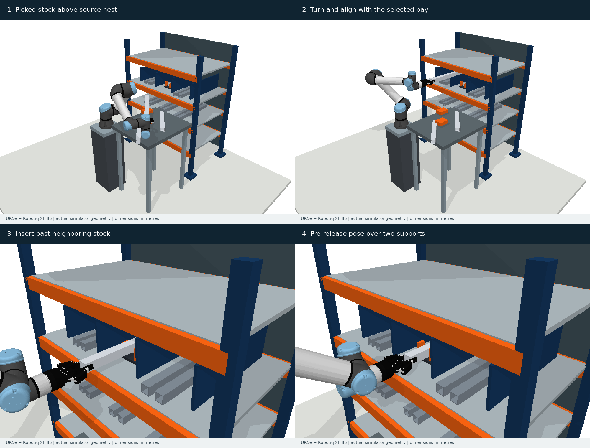

# 货架长条工件取放 benchmark v0.2

本版围绕**仓储／线边料架中取放长条工件**重建。任务是从备料架上方携带已抓持工件，转向、进入指定货位、对准两处支承；反向任务从货位中取出。原来的五类矩形开口保留为 v0.1 受控诊断集，不再作为主应用场景。



## 场景中有什么

- **UR5e 六自由度机械臂＋Robotiq 2F-85**。使用两家厂商公开仓库的模型、碰撞网格和安装转接件；保留官方视觉几何，夹爪不再由三个方块替代。
- **可占用的多层料架**：立柱、横梁、层板、货位隔板、后挡板、两处支承及导向块。指定货位之外有真实参与碰撞的邻近库存。
- **备料区和安装环境**：工作台、支承座、待取工件、机器人底座和地面，均参与碰撞检查。
- **空心长方管**：四片壁板组成，保留管口空腔；没有用凸包封住整个空心管。方管截面 40 × 40 mm、壁厚 3 mm，端部抓持，抓持点后方余量 20 mm。
- **存入与取出**：必须在指定货位完成完整进入／退出，检查实际工件终点和支承覆盖；只把末端送到某个点不算完成。

这是一组有工程尺寸和作业约束的**自建设计场景**。料架、工作台、支承和库存布局由本项目建模，未声称复刻某个仓库或经过现场测量。UR5e 对应的是线边短料／切断件存取单元；460–560 mm 长的工件不代表数米长原材的整仓搬运。

## 三个母场景，六个方向任务

| 几何配置 | 方管长度 | 货位中心 y | 抓持点至前端 | 场景差异 |
|---|---:|---:|---:|---|
| central_bay | 500 mm | 0 mm | 480 mm | 中间货位，两侧存货 |
| side_bay | 460 mm | +260 mm | 440 mm | 横移至侧边货位，腕部构型变化 |
| deep_bay | 560 mm | −260 mm | 540 mm | 更长悬伸，深处支承位置改变 |

每个母场景各有 `store` / `retrieve` 两个任务，共六个任务。取出路径是存入可行性路径的反向，**不能把它们统计成六个独立几何样本**。三种配置是开发用工程场景，没有人为称为 easy / medium / hard，也尚未冻结测试集。

货架宽 1.10 m、前后立柱中心距 0.63 m、立柱高 1.42 m；货架前缘 x=0.75 m，机械臂安装面 z=0，地面 z=−0.75 m。目标层板上表面 z=0.169 m，支承上表面 z=0.181 m。终点名义管底距支承 8 mm；两侧导向块内间距 64 mm，对 40 mm 方管给出每侧 12 mm 名义净空。尺寸是设计输入，不是厂商货架规格。

按铝密度 2700 kg/m³ 和理想空心截面估算，方管质量约 0.55–0.67 kg。该质量仅用于解释任务尺度；当前计算是运动学仿真，未验证夹持力、抗滑移或力矩承载。

## 为什么能研究抓持位姿误差

抓持变换沿整条执行保持固定：

`T_WO(q, ξ) = T_WE(q) · [Exp_SO3(φ), δt] · T_EO`

平移与旋转向量都在 TCP 坐标系中定义；这不是完整 SE(3) twist 指数。每个 episode 只抽一次误差，不能在每个轨迹点重新抽样。默认每轴平移标准差 **2 mm**、每轴旋转向量标准差 **1°**，支持平移、旋转和联合误差，以及缩放系数。参数是未标定的合成设定，标准差不是误差上限。

以 500 mm 工件为例，抓持点至前端 480 mm，绕横向轴偏转 1° 约产生 8.4 mm 的前端位移。这与 12 mm 侧向净空处于同一量级，因此导向块、隔板、邻料和深处支承都会影响执行。环境模型、夹爪和工件均检查碰撞；仅两块指尖接触链接允许与被抓工件接触，夹爪基座、连杆及机械臂其他链接仍检查。

## 成功条件与任务边界

起始关节状态固定。目标是**工件位姿区域**：位置容差 12 mm、姿态容差 5°，并且还需满足指定货位、完整进入／退出和双支承覆盖。`q_goal` 只是一个可行的参考逆解，其他满足目标区域的末端构型同样允许，避免将规划器锁死在单一终点。

存入任务还要求：管身覆盖两个支承，各支承处管底的预释放净空为 2–20 mm，不能悬在支承之外。碰撞和目标未达分别报告。RRT 基线当前只连接到参考 `q_goal`，尚未采样目标区域；这是该基线的限制。

六个搬运任务从“已抓持、已抬离支承”的状态开始，到预释放／搬运交接位姿结束。抓取闭合、最后 8 mm 接触落放和松爪过程没有进行动力学仿真。另提供**空夹爪退出审计**：假设工件已落在支承上，换用完全打开的官方夹爪几何，检查退出货架的路径和出口净空；不能据此声称已验证完整接触操作或实机执行。

碰撞采用 PyBullet 离散检查。名义审计与误差评估步长为每关节最大 0.0025 rad，可加密；网格接触使用 PyBullet 加载表示，不是精确 CAD 连续碰撞证明。夹爪连杆固定为一个平行抓持构型，误差模型不包含接触柔顺、滑移、视觉估计过程或伺服跟踪误差。

## 运行与检查

在本目录执行。运行时不需要 ROS、Isaac Sim 或网络，模型已经随目录提供。

```bash
python3 -m venv .venv
.venv/bin/python -m pip install -r requirements-lock.txt

# 重新生成至新目录，保留原始任务不覆盖
bash tools/python.sh -m rackbench.generate --output data/my_rack

# 六个任务名义验证 + 三个空夹爪退出检查
bash tools/python.sh -m rackbench.audit --data data/rack_v0.2 --output results/my_rack_audit

# 规划器只读取场景，不读取 reference_witnesses
bash tools/python.sh -m rackbench.plan \
  --scene data/rack_v0.2/tasks/central_bay_store.json \
  --output results/my_rack_rrt --seed 0 --budget 30

bash tools/python.sh -m rackbench.evaluate \
  --scene data/rack_v0.2/tasks/central_bay_store.json \
  --path results/my_rack_rrt/trajectory.npy \
  --output results/my_rack_rrt/evaluation.json --episodes 128

bash tools/python.sh -m rackbench.render \
  --scene data/rack_v0.2/tasks/central_bay_store.json \
  --path data/rack_v0.2/reference_witnesses/central_bay_store.npy \
  --output previews/my_rack --video

bash tools/python.sh -m pytest -q tests/test_rackbench.py
```

`reference_witnesses` 是名义可行性证据，用于检查生成任务是否有效，不能作为待比较规划器的输入。演示视频播放该参考路径，按关节弧长采样，不代表经过速度、加速度和力矩约束的控制轨迹。当前测试结果见 `RACK_RESULTS.zh-CN.md`，原始 episode 误差和结果在 `results/rack_v0.2/`。

## 模型来源与后续实验协议

- [Universal Robots 官方描述仓库](https://github.com/UniversalRobots/Universal_Robots_ROS2_Description)，固定提交 `78c5afd8bfee78a459c0265304340a85f1d44792`。
- [Robotiq 官方 ROS 仓库](https://github.com/robotiq/robotiq-ros)，固定提交 `157c4a62b66166c2bcaf04503e141a40b250fb3c`。2F-85 型号见[厂商产品页](https://robotiq.com/products/adaptive-grippers)。
- `assets/ur5e_robotiq/provenance.json` 包含处理步骤、固定关节值和资产 SHA256；两家的许可证分别保留。视觉 DAE 转 OBJ，碰撞 STL 保留。
- 仅在重新准备资产时，需要 xacro、trimesh 和 pycollada；脚本为 `tools/prepare_rack_robot.py`，不属于日常运行依赖。

下一阶段的独立测试集应按**几何母场景**拆分，改变货架深度／层高／目标货位、库存占用、工件长度／截面和抓持偏移；存入与取出不能跨集合泄漏。同一任务的规划方法使用相同执行误差样本，内部规划采样使用另外的种子。不能根据误差结果筛掉失败场景，也不能仅靠复制这三种布局扩大样本数。

真正支持实用性结论还需要实物料架或可追溯 CAD 尺寸、抓持误差标定，以及至少一组实机存取验证。本版把可公开重建、可检查的作业几何和规划评估先落实，不把开发场景结果当成工业部署证据。
