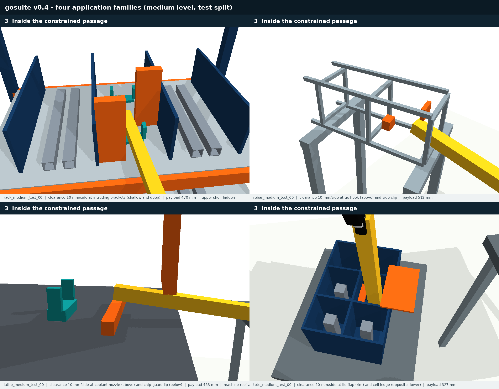
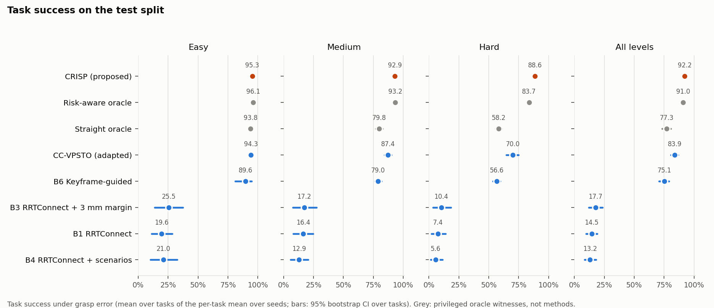
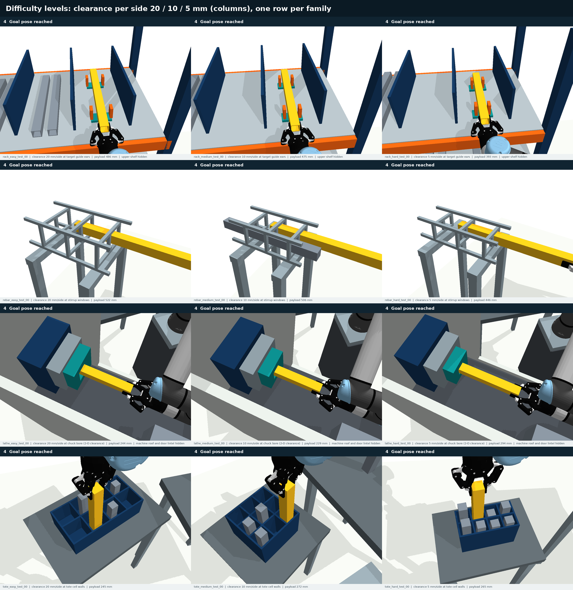

# Grasp Opening Benchmark

[中文说明](README.zh-CN.md) · [Suite v0.4 (current)](SUITE_v0.4.md) · [Proposed method: CRISP](docs/CRISP.md) · [Paper draft](paper/manuscript.md) · [Why v0.4](docs/BENCHMARK_ASSESSMENT_v0.3.md) · [Suite v0.3](SUITE_v0.3.md) · [Project status](PROJECT_STATUS.zh-CN.md)

A reproducible benchmark for transporting **grasped elongated workpieces through constrained openings under grasp-pose uncertainty**, an experiment harness that runs baselines directly, and a proposed planner, **CRISP**, that maximises the probability of success under the in-hand error.

**Status: research code with a complete simulation study; not a published journal result.** Simulation is kinematic (PyBullet) with a UR5e and a Robotiq 2F-85 gripper; the grasp-error model is uncalibrated; there is no real-robot evidence yet.



## v0.4 suite (current)

v0.4 puts the level-controlled obstacles where the payload tip, which has the largest lever arm, must pass them during insertion. Goals keep slack, so the risk is decided by the path rather than by the goal state. Every task stores two oracle paths: a straight insertion and a risk-optimised one. Their measured success gap is the room a robust planner has to show its value. On the frozen test split, a keyframe-guided planner that follows the openings but ignores uncertainty reaches 75.1% task success, close to the straight oracle (77.3%); the risk-aware oracle reaches 91.0% and is 27.0 points above the guided planner at the hard level. See [SUITE_v0.4.md](SUITE_v0.4.md), Section 5.

## Proposed method: CRISP

CRISP (chance-optimal insertion under in-hand grasp error) keeps the keyframe structure of the openings and optimises the insertion for the trajectory-level success probability. It uses:

- an exact, vectorised separating-axis risk model with lossless pruning (5-40 ms per candidate path);
- CMA-ES over the offsets of the payload's front and rear ends, which makes the lever arm explicit;
- a free goal pose inside the goal region;
- a Clopper-Pearson risk certificate.

It reads only the planner interface. It was developed on the dev split only; the frozen test split was run once.

| Test split, 72 tasks | Easy | Medium | Hard | All [95% CI] |
|---|---:|---:|---:|---:|
| **CRISP (proposed)** | 95.3 | 92.9 | 88.6 | **92.2** [91.0, 93.3] |
| Risk-aware oracle (privileged) | 96.1 | 93.2 | 83.7 | 91.0 [89.5, 92.4] |
| CC-VPSTO (IJRR 2026, re-implemented) | 94.3 | 87.4 | 70.0 | 83.9 [80.6, 86.8] |
| B6 keyframe-guided | 89.6 | 79.0 | 56.6 | 75.1 [70.7, 79.2] |

Paired over tasks (Wilcoxon, Holm-adjusted):

- CRISP − B6: +17.1 points, higher on 67/72 tasks, p = 8e-12.
- CRISP − CC-VPSTO: +8.4 points, higher on 63/72 tasks, p = 5e-11.
- CRISP − privileged oracle: +1.3 points, p = 0.029.

Ablations attribute the gain to three components:

| Ablation | Loss |
|---|---:|
| Error model without rotation (no lever arm) | -11.6 |
| Max-clearance instead of a probabilistic objective | -3.0 |
| Fixed instead of free goal pose | -2.0 |

Method, theory, protocol, all results and limitations: [docs/CRISP.md](docs/CRISP.md).



## v0.3 suite (calibration and sensitivity track)

| Component | Available |
|---|---|
| Families | Rack bay delivery, rebar cage threading, lathe chuck loading, kitting tote insertion |
| Tasks | 96 = 4 families x 3 clearance levels (20 / 10 / 5 mm per side) x (2 dev + 6 test) geometries |
| Task rules | Collision-free; per-state keep-in regions (e.g. enter only the target bay); ordered portals; payload goal region; placement |
| Evidence | Scene JSON, scripted feasibility witness, SHA-256 hashes, difficulty descriptors, rejection logs, an independent audit (96/96) |
| Evaluation | Fixed per-execution grasp perturbation (2 mm / 1 deg per axis), 256 common-random-number episodes, bootstrap CIs over tasks |
| Harness | Planner plug-in interface, parallel resumable runner, summary tables and figures |
| Built-in baselines | Reference oracle; RRT-Connect (nominal, margin-inflated, scenario) |
| Tests | `bash tools/python.sh -m pytest -q tests` |

Difficulty is calibrated by executing the scripted reference witnesses under the protocol. This is not a method comparison: see [SUITE_v0.3.md, Section 7](SUITE_v0.3.md#7-difficulty-calibration-reference-witnesses-oracle).



## Quick start

Tested with Python 3.10 on Linux; no ROS, Isaac Sim, private submodules or network access is needed after installing dependencies.

```bash
git clone https://github.com/dingzhen60027/grasp-opening-benchmark.git
cd grasp-opening-benchmark
python3.10 -m venv .venv
.venv/bin/python -m pip install -r requirements-lock.txt
bash tools/python.sh -m pytest -q tests
bash tools/python.sh tools/check_evidence.py
bash tools/python.sh -m gosuite.audit --suite data/suite_v0.4

# Run the baseline table (plan -> validate -> execute under common grasp errors -> tables)
bash tools/python.sh -m gosuite.experiment --config configs/experiment_baselines_v0.4.json

# Proposed method, comparator and ablations on the test split; then the paired tables and figures
bash tools/python.sh -m gosuite.experiment --config configs/experiment_crisp_v0.4.json
bash tools/python.sh -m gosuite.compare --config configs/comparison_crisp_v0.4.json
bash tools/python.sh -m gosuite.crisp_figures --main configs/comparison_crisp_v0.4.json --output results/suite_v0.4/comparison_crisp_test
```

To add your own planner, implement `plan(problem, seed, budget, **params)` and reference it as `"module:function"` in a config. [examples/custom_planner.py](examples/custom_planner.py) is a template; the interface is described in [SUITE_v0.3.md, Section 8](SUITE_v0.3.md#8-running-experiments).

## Earlier versions

- **v0.2 rack (`rackbench/`, `data/rack_v0.2/`)**: historical snapshot only. Its three reference storage paths enter the outer bay and slide sideways over the dividers into the target bay, and its success check examined the bay only at the final pose. The v0.3 rack family replaces it, with a per-state keep-in rule and reach-aware placement. Records: [RACK_BENCHMARK.zh-CN.md](RACK_BENCHMARK.zh-CN.md), [RACK_RESULTS.zh-CN.md](RACK_RESULTS.zh-CN.md).
- **v0.1 diagnostics (`gobench/`, `data/v0.1/`)**: five simplified opening families, 60 tasks, kept as a controlled diagnostic track ([DIAGNOSTIC_V0.1.zh-CN.md](DIAGNOSTIC_V0.1.zh-CN.md)).

## Repository map

- `gosuite/`: suites v0.3 and v0.4. Generator (`generate`), scene families (`families/`), world and collision checks (`world`), task rules (`task`), evaluator (`evaluate`), audit, planning interface (`planning`), baselines and methods (`planners/`: `crisp` proposed, `ccvpsto` comparator), grasp-error risk model (`risk`), harness (`experiment`, `report`, `compare`, `figures`, `crisp_figures`, `robustness`, `paper_tables`), validation (`validate`) and screenshots (`render`).
- `data/suite_v0.4/` (current) and `data/suite_v0.3/`: 96 tasks each, witnesses, manifest with hashes, rejection log.
- `configs/`: protocol, experiment and comparison configs. `results/suite_v0.4/`: audit, validation, oracle and baseline runs, CRISP runs (`crisp`, `crisp_dev`, `crisp_budget`), comparison tables and figures, robustness study; `results/suite_v0.3/`: audit, validation, reference evaluation, short baseline test and smoke runs.
- `previews/`: simulator screenshots; `assets/`: bundled models with licenses and SHA-256 provenance.
- `docs/`: design rationale, the proposed method ([CRISP.md](docs/CRISP.md)), TAPOM reproduction status, CI template. `paper/`: manuscript draft, references, generated LaTeX tables.

## Research status

Remaining work:

- calibrate the grasp-error distribution on hardware and run real-robot experiments;
- add arm awareness to CRISP's optimiser (3 of 360 test runs fall back to the straight insertion);
- validate the CVaR variant, which was slightly better on test but not selected on dev, on fresh tasks;
- adapt TAPOM ([arXiv:2511.05052](https://arxiv.org/abs/2511.05052)).

No acceptance or publication claim is made; the comparisons above are simulation results under an uncalibrated error model. Third-party assets retain their bundled licenses. A first-party project license has not yet been selected; see [the notices](THIRD_PARTY_NOTICES.md).
