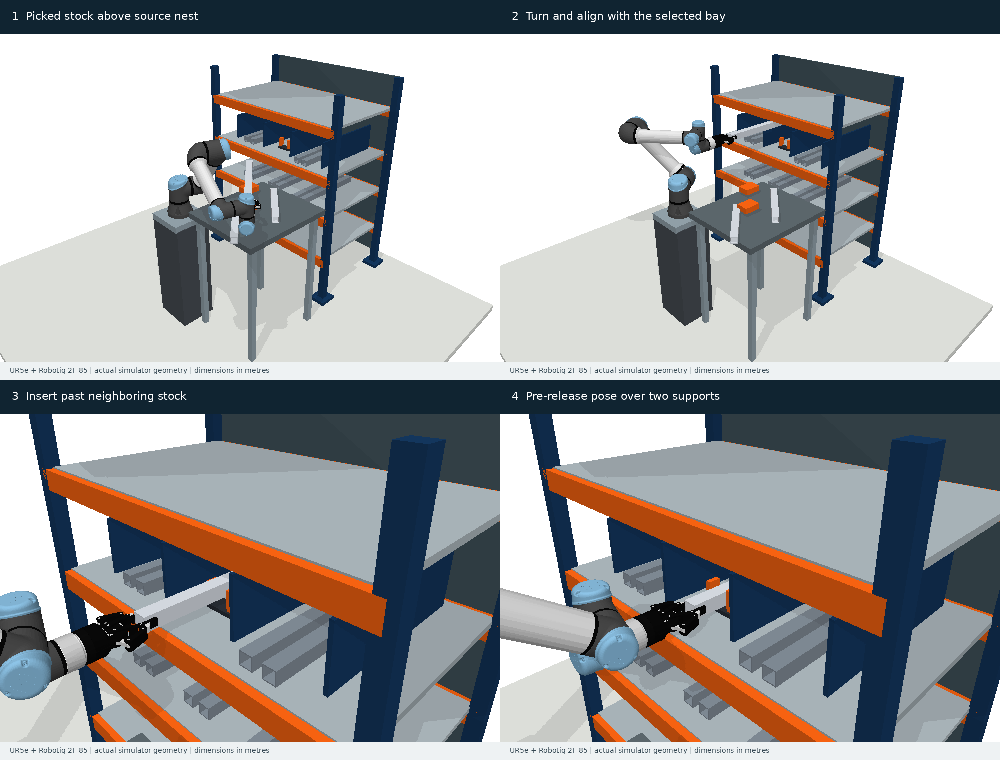

# 受限开口搬运与抓持位姿不确定性 benchmark

研究方向：**面向受限开口搬运的抓持位姿不确定性鲁棒机械臂规划**。

当前公开的是开发阶段的仿真平台、任务与实验记录。已经实现货架长条工件存取、误差回放和名义规划基线；**尚未实现本研究拟提出的鲁棒规划算法，尚未形成完整期刊论文结果**。



[演示视频](previews/rack_v0.2/central_bay/replay.mp4) · [当前进展与待办](PROJECT_STATUS.zh-CN.md) · [场景规范](RACK_BENCHMARK.zh-CN.md) · [实际验证结果](RACK_RESULTS.zh-CN.md)

## 已有内容

| 内容 | 当前状态 |
|---|---|
| 仿真平台 | PyBullet 3.2.7，UR5e 六自由度机械臂＋Robotiq 2F-85 官方模型 |
| 主应用 | 货架中存入／取出 460–560 mm 空心方管 |
| 数据规模 | 1 类应用、3 个几何配置、6 个方向任务；反向任务不算独立几何 |
| 作业环境 | 备料台、层板、横梁、立柱、隔板、邻近库存、双支承和导向块 |
| 不确定性 | 每条执行固定一个六维抓持误差，可做平移／旋转／联合回放 |
| 任务验证 | 整路径碰撞、完整进出、目标货位、工件目标区域及双支承覆盖 |
| 名义结果 | 六条存取参考轨迹和三条开爪退出路径全部通过检查 |
| 规划基线 | RRT-Connect 已接入；货架中完成一个任务、一个种子的实测 |
| 代码验证 | 16 项测试通过，模型版本、哈希、原始误差样本与结果已保存 |
| 受控诊断集 | v0.1 的五类简化几何、60 个任务继续保留，单独统计 |

参考轨迹仅用于证明任务名义可行，不是新鲁棒算法输出。当前布局是自建工程场景，不是现场测量得到的数字孪生。夹持力、滑移、抓取闭合、接触落放和控制器跟踪尚未模拟。

## 运行

已在 Linux、Python 3.10 上验证。运行时无需 ROS、Isaac Sim 或 ETH 私有模型。

```bash
git clone https://github.com/dingzhen60027/grasp-opening-benchmark.git
cd grasp-opening-benchmark
python3 -m venv .venv
.venv/bin/python -m pip install -r requirements-lock.txt
bash tools/python.sh -m pytest -q tests
bash tools/python.sh tools/check_evidence.py
bash tools/python.sh -m rackbench.audit \
  --data data/rack_v0.2 --output reports/nominal_audit
```

新实验使用 `reports/`，生成器和评估器要求新输出目录／文件，避免覆盖已有记录。规划、误差评估、生成与视频命令见[详细说明](RACK_BENCHMARK.zh-CN.md)。

本地检查已通过。GitHub 自动检查目前未启用：首次发布的登录凭据缺少 `workflow` 权限，工作流以[模板和启用说明](docs/CI_SETUP.md)保留。

## 实验结论的范围

三个货位的参考存入路径各运行了 128 次误差回放，在每轴 2 mm／1° 标准差下，碰撞分别为 39、37、40 次。同样误差下，中间货位的一条独立 RRT 路径碰撞 102/128 次。这说明任务对抓持误差敏感；不能据此宣称我们提出了优于 RRT 的鲁棒算法。

下一阶段包括方法创新与算法实现、已有方法适配、多几何独立测试集、消融实验、真实抓持误差标定和实机验证。完整状态见 [PROJECT_STATUS.zh-CN.md](PROJECT_STATUS.zh-CN.md)。

## 其他已有工作

- [v0.1 受控诊断集](DIAGNOSTIC_V0.1.zh-CN.md)：用于研究开口净空和误差敏感性。
- [TAPOM 部分复现状态](docs/TAPOM_REPRODUCTION_STATUS.md)：一个公开 ABB 场景成功，尚未完成全文统计复现或本仓库场景适配。
- [第三方模型与许可证](THIRD_PARTY_NOTICES.md)：保留厂商许可证和固定来源；项目自有代码许可证尚未选定。
