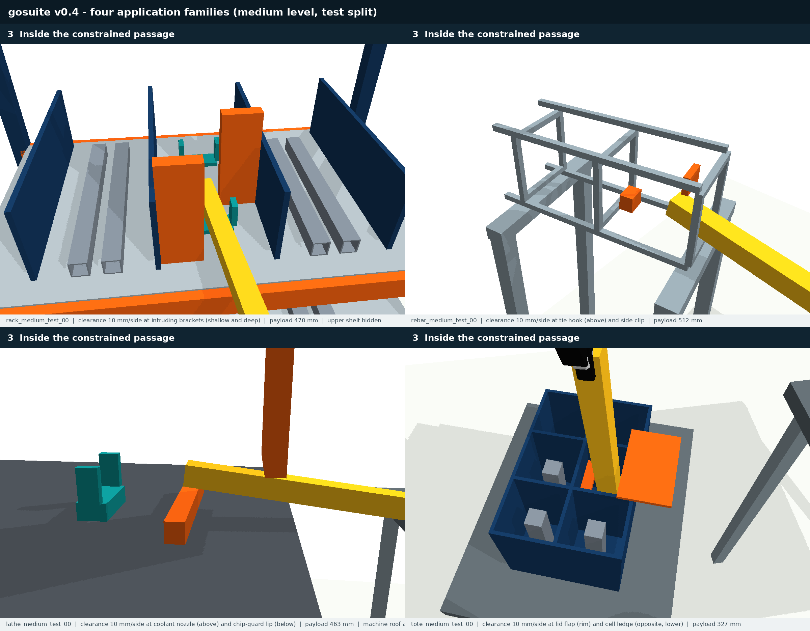
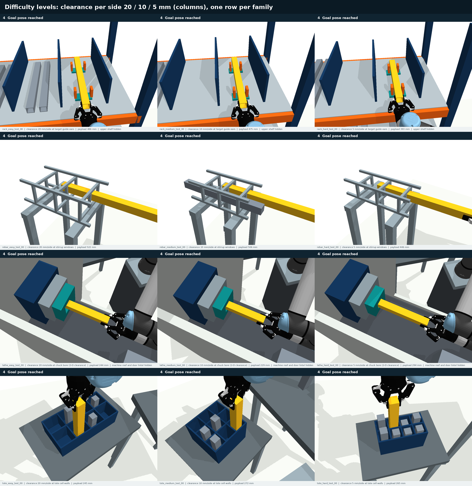

# 受限开口搬运与抓持位姿不确定性 benchmark

研究方向：**面向受限开口搬运的抓持位姿不确定性鲁棒机械臂规划**。

当前公开的是开发阶段的仿真平台、任务与实验工具。**v0.4 为当前版本**：风险由规划决定（障碍位于开口附近、由力臂最长的工件末端经过，目标留有余量），每个任务提供直线与风险优化两条参考路径。v0.3 保留为标定与敏感性实验。**尚未实现本研究拟提出的鲁棒规划算法，尚未形成完整期刊论文结果**。



[v0.4 规范（英文，当前）](SUITE_v0.4.md) · [为何需要 v0.4](docs/BENCHMARK_ASSESSMENT_v0.3.md) · [v0.3 规范](SUITE_v0.3.md) · [设计依据](docs/BENCHMARK_DESIGN_v0.3.md) · [当前进展](PROJECT_STATUS.zh-CN.md)

## v0.4 关键结果

在同一批评估误差采样上，风险优化参考路径与直线参考路径的成功率：困难 83.6% 对 57.8%（提升 25.8 个百分点），中等 93.4% 对 79.9%（13.5），容易 96.1% 对 93.7%（2.3）。关键帧引导基线（不考虑不确定性）约 77%，与直线参考路径相当，这一差距就是鲁棒规划方法的提升空间。详见 [SUITE_v0.4.md](SUITE_v0.4.md)。

## v0.3 已有内容（标定与敏感性实验）

| 内容 | 当前状态 |
|---|---|
| 仿真平台 | PyBullet 3.2.7，UR5e 六自由度机械臂＋Robotiq 2F-85 官方模型 |
| 应用场景 | 四类：货架指定货位存放、钢筋笼穿筋、车床卡盘上料、料盒分格插放 |
| 难度等级 | 每类三级，最紧特征的单侧名义净空 20／10／5 mm |
| 数据规模 | 96 个任务：4 类 × 3 级 ×（2 开发 + 6 测试）；每个任务都是独立采样的几何 |
| 任务判据 | 整路径碰撞；逐状态限定区域（例如只能进入目标货位）；按顺序穿过开口；工件目标位姿区域；货架双支承落放 |
| 质量控制 | 每个任务有脚本化可行性证据、SHA-256 哈希、难度描述量和拒绝记录；独立审计 96/96 通过 |
| 不确定性评估 | 每次执行固定一个六维抓持误差（每轴 2 mm／1°，未标定）；所有方法使用同一批 256 个误差样本 |
| 实验框架 | 规划器插件接口、并行可续跑执行器、汇总表与图；内置参考证据、RRT-Connect（名义／安全裕量／多场景）|
| 代码验证 | 31 项测试通过 |

参考证据路径在同一误差协议下的成功率：容易 93.4%、中等 76.1%、困难 37.8%，各类场景均随难度单调下降。这用于标定难度，不是方法比较（详见 [SUITE_v0.3.md 第 7 节](SUITE_v0.3.md#7-difficulty-calibration-reference-witnesses-oracle)）。



## 运行

已在 Linux、Python 3.10 上验证。运行时无需 ROS、Isaac Sim 或 ETH 私有模型。

```bash
git clone https://github.com/dingzhen60027/grasp-opening-benchmark.git
cd grasp-opening-benchmark
python3 -m venv .venv
.venv/bin/python -m pip install -r requirements-lock.txt
bash tools/python.sh -m pytest -q tests
bash tools/python.sh -m gosuite.audit --suite data/suite_v0.3

# 运行基线：规划 → 名义校验 → 同一批抓持误差下执行 → 汇总表
bash tools/python.sh -m gosuite.experiment --config configs/experiment_baselines_v0.3.json
```

接入自己的基线：实现 `plan(problem, seed, budget, **params)`，在配置中写成 `"模块:函数"`。模板见 [examples/custom_planner.py](examples/custom_planner.py)。

## 旧版本

- **v0.2 货架（`rackbench/`）**：仅作历史快照。其三条参考存入路径先把方管伸入外侧空货位，再越过隔板横移到目标货位；旧判据只在终点检查货位，因此未能发现。v0.3 货架场景用逐状态限定区域判据和可达性约束重建。
- **v0.1 诊断集（`gobench/`）**：五类简化开口、60 个任务，作为受控诊断保留（[DIAGNOSTIC_V0.1.zh-CN.md](DIAGNOSTIC_V0.1.zh-CN.md)）。

## 其他

- [TAPOM 部分复现状态](docs/TAPOM_REPRODUCTION_STATUS.md)：一个公开 ABB 场景成功，尚未适配本仓库场景。
- [第三方模型与许可证](THIRD_PARTY_NOTICES.md)：保留厂商许可证和固定来源；项目自有代码许可证尚未选定。
