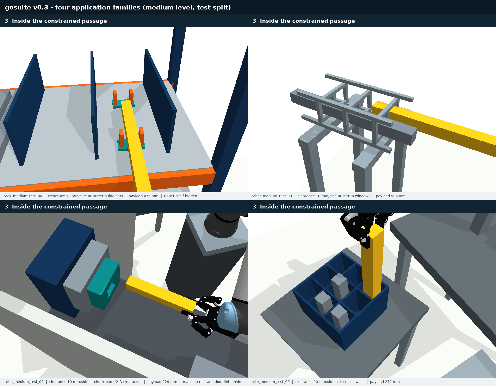
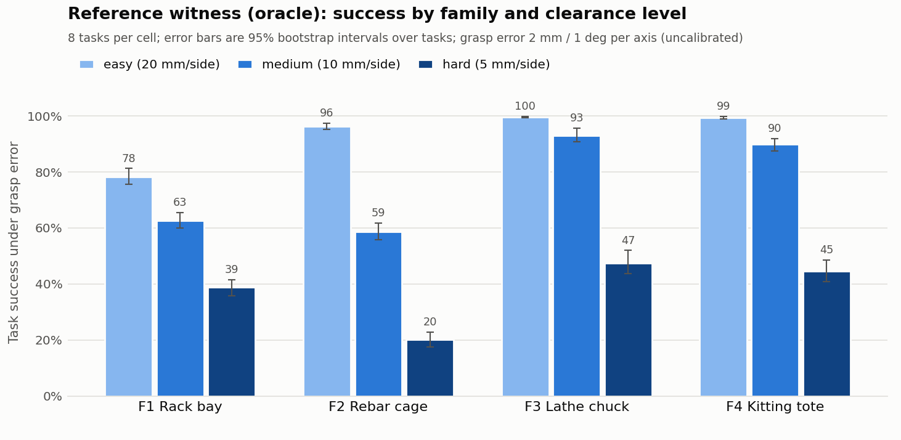

# gosuite v0.3: grasp-opening benchmark suite

A multi-environment benchmark for **moving a grasped elongated payload through constrained openings when the in-hand grasp pose is uncertain**, with a ready-to-use experiment harness for baselines.

**Status:** development benchmark, 2026-11-11. The suite, protocol, evaluation and harness are complete and tested. Baseline tables are not yet produced; the reference (oracle) evaluation below calibrates difficulty only. Simulation is kinematic (PyBullet), the uncertainty model is uncalibrated, and there is no real-robot evidence.



| Item | Value |
|---|---|
| Robot | UR5e + Robotiq 2F-85 (manufacturer models, `assets/ur5e_robotiq`) |
| Families | 4 application families: rack, rebar, lathe, tote |
| Difficulty | 3 clearance levels per family: 20 / 10 / 5 mm per side at the tightest feature |
| Instances | 96 tasks = 4 families x 3 levels x (2 dev + 6 test); each task is its own sampled geometry |
| Evidence per task | scene JSON, scripted feasibility witness, SHA-256 hashes, difficulty descriptors |
| Validation | 96/96 witnesses re-validated at 0.0025 rad by an independent audit (`results/suite_v0.3/audit.json`) |
| Uncertainty | fixed grasp perturbation per execution, 2 mm and 1 deg per axis (uncalibrated), scale sweep |
| Evaluation | 256 common-random-number episodes per run; planning samples come from a separate stream |
| Code | `gosuite/` (generator, world, task rules, evaluator, harness, renderer); 31 tests (16 legacy + 15 suite) |
| Generation | 96/96 cells filled with 45 rejected attempts in total (`data/suite_v0.3/rejections.json`) |

## 1. Problem

The robot holds a rigid payload with nominal grasp `T_EO`. During execution the true grasp is

`T_WO(q, xi) = T_WE(q) . [Exp_SO3(phi), dt] . T_EO`,   `xi = (dt, phi) ~ N(0, diag(sigma^2))`,

drawn **once per execution** and held for the whole trajectory. A planner receives the task file (scene, start configuration, goal region, nominal grasp, sigma). It never receives the witness. It returns a joint path. Success means the path is nominally valid **and** the execution under the drawn grasp error stays collision-free and satisfies every task rule.

## 2. Environment families

Every family is a parameterised template. Instances are sampled from it and accepted only after a scripted witness passes the full validation (Section 4). Detailed boards: [rack](previews/suite_v0.3/rack_workflow.png), [rebar](previews/suite_v0.3/rebar_workflow.png), [lathe](previews/suite_v0.3/lathe_workflow.png), [tote](previews/suite_v0.3/tote_workflow.png), [all levels](previews/suite_v0.3/levels.png).

| ID | Family | Application (related work) | Tightest feature (level-controlled) | Other constraints | Sampled parameters |
|---|---|---|---|---|---|
| F1 | `rack` | Part delivery into industrial shelving (TAPOM PD) | Guide ears at two destination saddles | Enter **only** the target bay (keep-in); neighbouring stock; pre-release 2-20 mm above both saddles | bay (3), tube length 0.38-0.50 m, tier height and spacing, rack placement within reach, stock occupancy |
| F2 | `rebar` | Bar threading through a reinforcement cage (TAPOM RA) | 2-4 coaxial stirrup windows | Never enter the neighbouring window (often occupied); windows crossed in order | ring count and spacing, cage pose and yaw, height, bar length 0.42-0.54 m, final tip position |
| F3 | `lathe` | CNC machine tending | Square chuck bore (2-D clearance) | Broadside entry through the machine door with the wrist inside the enclosure; then axial insertion | machine pose and yaw, spindle height and depth, chuck side, door size, bar length 0.20-0.30 m, insertion depth |
| F4 | `tote` | Kitting / part presentation | Tote cell walls | Vertical top-down insertion among neighbouring parts that may protrude above the dividers | grid 2x3 to 3x4, target cell, tote pose and yaw, cell height, occupancy, rod length 0.24-0.32 m |

All families share the work cell (floor, pedestal, base plate) and a source fixture from which the payload starts, already grasped and 80 mm above its nest. Hollow payloads (rack) are unions of walls, so their bore stays open.

## 3. Task semantics

Validity and success are evaluated by one generic checker (`gosuite/task.py`). Nothing geometry-specific is hard-coded; every rule is declared in the task file.

1. **Collision-free:** robot-environment, payload-environment, robot self-collision and payload-arm contact. Payload contact with the hand is excluded, because the grasp perturbation is the payload pose inside the hand.
2. **Keep-in (per state):** any part of the payload inside a restricted box must lie inside the allowed box. It is tested exactly, by clipping 17 payload line segments. This replaces the v0.2 rack check, which looked at the bay only at the final pose. A v0.2-style path that enters the outer bay and slides sideways is collision-free but is now rejected (`keep_in:rack_target_bay`); see `tests/test_suite.py`.
3. **Portals (path-level):** a payload reference point crosses each declared opening inside its rectangle, in order, and stays beyond it.
4. **Goal region:** payload pose within 10-12 mm and 5 deg of the goal. `q_goal_reference` is only one IK solution.
5. **Placement (rack):** the centreline lies over both saddles with a 2-20 mm pre-release gap. This tolerance is fixed across levels, so even the easy rack level contains a placement challenge.

Planners see rules 1-2 through `PlanningProblem.check`. Rules 3-5 are checked by `PlanningProblem.validate` and by the evaluator.

## 4. Generation and quality control

- **Seeding:** every (family, level, split, index) has its own SHA-256-derived seed (master seed 20261111). Parameters are re-sampled until a witness is accepted. All rejections are logged (`data/suite_v0.3/rejections.json`).
- **Witnesses:** scripted TCP waypoints followed by IK continuation from several seeds. Lateral alignment always happens outside the restricted region. The witness is densified to 0.005 rad and validated at 0.0025 rad with the evaluator's own validator.
- **Layout check:** an exact PyBullet check rejects stations that intersect the source fixtures or crowd the robot mount.
- **Difficulty isolation:** a witness is rejected if it passes within 15 mm of anything other than the family's designed tight features. This keeps difficulty controlled by the level rather than by incidental near-misses.
- **Reach-aware placement:** for example, the rack front is placed so that the pre-insertion pose (tube fully outside the facade, aligned with the bay) is reachable. With the tool horizontal straight ahead, the UR5e TCP reaches only about 0.42-1.06 m.
- **No selection on outcomes:** instances are never filtered on uncertain outcomes or planner success.

Each task stores BARN-style difficulty descriptors: design clearance, lever arm, minimum nominal clearance, constrained path length (TCP travel with payload clearance below 20 mm), portal count, tip sensitivity `c / (lever * sigma_r)` and the closest features.

## 5. Splits

Per family and level there are 2 **dev** and 6 **test** geometries. Tune any planner parameter (margins, sample counts, step sizes) on dev only. The test split is frozen by the hashes in `data/suite_v0.3/manifest.json`. This is the geometry-level hold-out used by Gaebert et al. (ICRA 2023) and BARN.

## 6. Evaluation protocol

Defined in `configs/protocol_v0.3.json`.

- **Paths:** densified to 0.0025 rad per joint and validated nominally. The start must equal `q_start`; the end may be anywhere in the goal region.
- **Execution:** 256 episodes per run (1024 for headline numbers). The grasp perturbations are drawn from `rng([evaluation_seed, 0])` and are identical for every method (common random numbers). Planners may draw only from `rng([evaluation_seed, 1, seed])`, through `PlanningProblem.planning_errors`.
- **Episode failure:** the first payload-environment or payload-arm contact, or any violated task rule.
- **Planning:** 5 seeds per task; a 120 s budget for the main table and 600 s on the hard subset (comparable to TAPOM's 600 s). A planning failure counts as a task failure. A budget sweep {30, 120, 600} s is recommended, because a 30 s smoke run of RRT-Connect solved few rebar and lathe tasks (Section 8).
- **Metrics:** planning success; task success (unconditional); collision rate given a valid path; planning time; joint and TCP path length; minimum nominal payload clearance. Aggregates are reported per family, per level and overall, with 95% bootstrap intervals over tasks.
- **Ablations supported:** uncertainty scale {0, 0.5, 1, 1.5, 2} and translation-only / rotation-only modes.

## 7. Difficulty calibration: reference witnesses (oracle)

The scripted witnesses, executed under the protocol above. **These rows calibrate difficulty; they are not a method.** The witnesses were not optimised for robustness.

Task success under 2 mm / 1 deg grasp error, 256 episodes per task, all 8 tasks per cell (dev + test). Brackets are 95% bootstrap intervals over tasks. Source: `results/suite_v0.3/reference/summary.md`.

| Family | Easy (20 mm) | Medium (10 mm) | Hard (5 mm) | All levels |
|---|---:|---:|---:|---:|
| F1 rack | 78.3% [75.6, 81.3] | 62.6% [60.0, 65.6] | 38.8% [35.7, 41.5] | 59.9% [53.1, 66.7] |
| F2 rebar | 96.2% [95.1, 97.5] | 58.7% [55.7, 61.9] | 20.3% [17.6, 22.9] | 58.4% [45.6, 71.0] |
| F3 lathe | 99.7% [99.4, 99.9] | 93.1% [90.9, 95.6] | 47.4% [43.7, 52.0] | 80.1% [69.9, 89.2] |
| F4 tote | 99.4% [99.0, 99.8] | 89.9% [87.5, 91.9] | 44.6% [40.8, 48.6] | 78.0% [67.7, 87.5] |
| **All** | **93.4% [90.0, 96.4]** | **76.1% [70.2, 81.6]** | **37.8% [33.5, 41.8]** | **69.1% [63.5, 73.8]** |

What the calibration shows:

- **The levels separate in every family.** Success falls monotonically from easy to hard.
- **Failures sit at the designed tight features.** Hard-level failures are almost all first contacts at the family's tight feature: guide ears, the first stirrup, the chuck jaws, the cell dividers.
- **Rack easy is lower for a known reason.** Its easy level is held down by the fixed 2-20 mm placement tolerance: saddle contacts and pre-release-height violations under grasp rotation.
- **The hard levels leave room for robust methods.** No reference witness reaches 50% success on the hard level.



## 8. Running experiments

```bash
# environment (Python 3.10)
python3 -m venv .venv && .venv/bin/python -m pip install -r requirements-lock.txt

# checks
bash tools/python.sh -m pytest -q tests
bash tools/python.sh -m gosuite.audit --suite data/suite_v0.3

# regenerate the suite into a fresh directory (deterministic for a fixed seed)
bash tools/python.sh -m gosuite.generate --output data/my_suite --workers 16

# baselines: plan -> validate -> execute under common grasp errors -> summary tables
bash tools/python.sh -m gosuite.experiment --config configs/experiment_baselines_v0.3.json
bash tools/python.sh -m gosuite.report results/suite_v0.3/baselines
bash tools/python.sh -m gosuite.figures results/suite_v0.3/baselines --label "RRT-Connect"

# evaluate any externally produced path
bash tools/python.sh -m gosuite.evaluate --task data/suite_v0.3/tasks/rack/test/rack_hard_test_03.json \
  --path my_path.npy --output reports/my_eval.json --episodes 256

# screenshots
bash tools/python.sh -m gosuite.render --suite data/suite_v0.3 --output previews/suite_v0.3
```

### Adding your baseline

Write `plan(problem, seed, budget, **params) -> gosuite.planning.PlanResult` (template: [examples/custom_planner.py](examples/custom_planner.py)). Then add `{"label": "...", "planner": "your_module:plan", "params": {...}}` to a config. The harness:

- runs every (planner, task, seed) in a worker pool, with resume by skipping finished runs;
- times planning against the budget;
- saves each trajectory;
- runs nominal validation and the common-random-number execution;
- writes one JSON per run (including per-episode success and collision bitstrings for paired tests), `runs.csv`, `summary.csv` / `summary.md` / `summary.json`.

Built-in baselines (`gosuite/planners`):

| Name | Description |
|---|---|
| `reference` | Witness oracle (difficulty calibration only) |
| `rrt_connect` | Seeded joint-space RRT-Connect with shortcut smoothing |
| `rrt_connect` + `margin` | Payload-environment safety margin, i.e. TAPOM-style obstacle inflation |
| `rrt_connect` + `scenarios` | Every state also valid for N planning-time grasp samples (scenario / particle approximation of a chance constraint) |

`configs/experiment_baselines_v0.3.json` runs the three RRT variants on the test split (5 seeds, 120 s, 256 episodes). Tune the margin, N and risk on dev first. The margin and scenario conditions apply to every state except the given start and goal configurations. The goal lies inside the tight feature by design, so its inherent risk is not the planner's choice. If a robust condition makes the approach to the goal infeasible, the run is a planning failure.

**Pipeline smoke test** (`configs/experiment_smoke_v0.3.json`; dev split, 1 seed, 30 s, 64 episodes; results in `results/suite_v0.3/smoke_rrt_dev`). This shows the harness works end to end; it is **not** a baseline result.

| Variant | Planning success | Task success [95% CI over tasks] | Collision rate given a valid path |
|---|---:|---:|---:|
| RRT-Connect | 4/24 | 9.0% [1.8, 17.5] | 41.8% |
| Margin RRT-Connect (5 mm) | 3/24 | 9.2% [0.0, 20.4] | 12.0% |
| Scenario RRT-Connect (N=8, risk 0.25) | 4/24 | 11.3% [2.3, 21.7] | 27.0% |

All failures were timeouts. No variant solved a rebar or lathe task within 30 s; see the budget probe below.

**Budget probe** (`configs/experiment_budget_probe_v0.3.json`; plain RRT-Connect, 300 s, rebar and lathe dev tasks, 1 seed; results in `results/suite_v0.3/probe_rrt_300s`):

- **Lathe:** 2/6 solved, with first solutions at 79 s and 244 s.
- **Rebar:** 0/6 solved, although every task has a verified witness.
- **Search rate:** the trees reach only about 2,000 nodes in 270 s. Every edge is collision-checked at 0.005 rad against the full arm, gripper and payload model.

Threading coaxial windows is a narrow-passage problem that unguided joint-space sampling rarely solves. This matches TAPOM's motivation for keyframe-guided planning. For meaningful baseline tables, add a guided or optimisation-based planner (for example OMPL planners, Cartesian-keyframe guidance or TAPOM) and use the 600 s budget on the hard subset.

## 9. Scope and limitations

- **Kinematic only:** no contact dynamics, slip, grasp closure or controller tracking error. The fixed per-execution grasp error is the only stochasticity.
- **Uncalibrated uncertainty:** 2 mm / 1 deg are design values; use the scale sweep for sensitivity.
- **No certificates:** discrete collision checking at 0.0025 rad and finite Monte Carlo samples give no continuous-safety or worst-case guarantee.
- **Synthetic scenes:** layouts are engineered and dimensioned, not measured digital twins. Square sections stand in for round bars.
- **Planner goal:** the provided RRT baselines connect to `q_goal_reference` rather than sampling the goal region.
- **TAPOM:** not yet adapted (`docs/TAPOM_REPRODUCTION_STATUS.md`).

The design rationale and how each choice maps to related benchmarks (TAPOM, MotionBenchMaker, Gaebert et al., BARN, MPiNets) are in [docs/BENCHMARK_DESIGN_v0.3.md](docs/BENCHMARK_DESIGN_v0.3.md).
