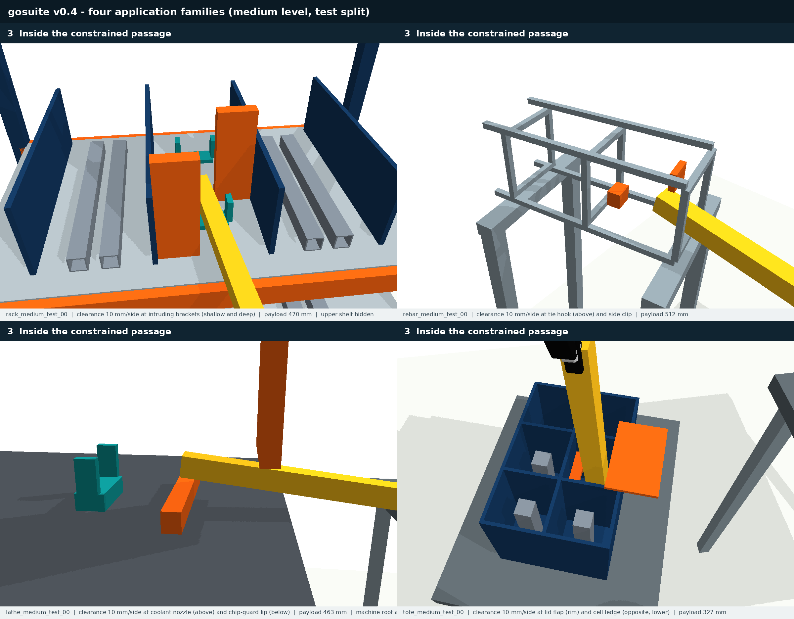
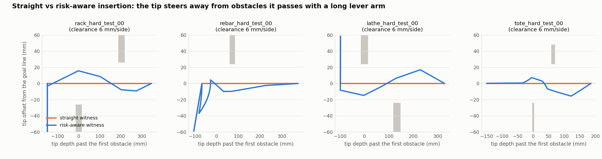

# gosuite v0.4: grasp-opening benchmark with planner-controllable risk

v0.4 is the current benchmark for robust planning under grasp-pose uncertainty. It replaces v0.3 for the paper's main claim. v0.3 is kept as a calibration and sensitivity track. The reason is documented in [docs/BENCHMARK_ASSESSMENT_v0.3.md](docs/BENCHMARK_ASSESSMENT_v0.3.md): in v0.3, the risk was decided almost entirely by the goal state, so no planner could do much better than one that passes the openings centred.

**Status:** development benchmark, 2026-11-12. The suite, the two oracle witnesses per task, the validation, the harness and the full baseline experiment on the frozen test split are complete (Section 5). Simulation is kinematic (PyBullet), the uncertainty model is uncalibrated, and there is no real-robot evidence.



## 1. What changed and why

Under a fixed in-hand grasp error ξ = (δt, φ), a payload point p (in the gripper frame) moves by about δt + φ × p. The deviation therefore grows with the lever arm, i.e. the distance from the grasp. v0.4 places the difficulty where this makes planning decisions matter:

- **Obstacles near the opening, goal deep inside.** Level-controlled obstacles (brackets, fittings, hooks, flaps, ledges) sit close to the opening. During insertion the payload *tip*, which has the largest lever arm, has to pass them. At the goal only short-lever points are next to them.
- **Goals with slack.** Saddles, pads, stirrups and cells keep 25–45 mm of slack, so the goal state itself carries little risk.
- **Two sides, two depths.** One obstacle sits shallow on one side and one sits deeper on the other side, about 0.1–0.2 m apart. When the tip reaches the deep one, the payload body next to the shallow one has a much shorter lever arm, so a lever-aware planner should tilt the payload rather than simply centre it.

A straight insertion along the goal line passes every obstacle with the tip at clearance *c*. A risk-aware insertion steers the tip away and converges to the goal line only when short-lever points are next to the obstacles. Every task stores both paths:

| Witness | How it is made | Role |
|---|---|---|
| `witness` (risk-aware oracle) | Cross-entropy search over the insertion segment, scored on 80 **planning-stream** grasp draws (seed 9001); the best candidate the arm can execute | Shows what a risk-aware path achieves |
| `witness_nominal` (straight oracle) | Straight insertion along the goal line | What a risk-unaware structured planner does |

Neither witness was selected on the evaluation draws, so their success on those draws is an unbiased measure of the headroom.

## 2. Families

| ID | Family | Application | Level-controlled obstacles (clearance *c* on the goal line) | Goal slack |
|---|---|---|---|---|
| F1 | `rack` | Part delivery into a shelf bay | Full-height brackets: shallow on one side, deep on the other (lateral trade-off) | Saddles with 25 mm guides; 2–30 mm pre-release window |
| F2 | `rebar` | Bar threading into a cage | Tie hook from above (shallow) and side clip (deeper), in orthogonal planes | Stirrup windows 45 mm around the bar |
| F3 | `lathe` | Machine tending, axial loading | Coolant nozzle from above (shallow) and chip-guard lip from below (deep): vertical trade-off | Fixture pad with 25 mm guides |
| F4 | `tote` | Kitting into a divided tote | Half-open lid flap above the rim (shallow) and cell ledge on the opposite wall (deep) | Cell 30 mm around the rod |

Levels: *c* = **16 / 10 / 6 mm** (easy / medium / hard). Each family × level has 2 dev and 6 test geometries, giving **96 tasks**. Task rules, splits, uncertainty model, evaluation protocol and metrics are the same as in v0.3; see [SUITE_v0.3.md](SUITE_v0.3.md) and [configs/protocol_v0.4.json](configs/protocol_v0.4.json).

## 3. Acceptance checks (before any baseline table)

Acceptance criteria, defined in advance in the assessment:

| Criterion | Target | Result |
|---|---|---|
| Goal-state failure at the hard level | ≤ 15% | 13.4% ✓ (rack alone: 17.2%) |
| Risk-aware − straight witness, medium | ≥ 15 points | +13.5: narrowly missed (rack +17.2, rebar +16.1, lathe +13.7, tote +7.1) |
| Risk-aware − straight witness, hard | ≥ 15 points | +25.8 ✓ (every family +19 to +29) |
| Evaluation-step convergence, monotone sensitivity, descriptor validity, reproducibility | as in v0.3 | step halving changed 0 of 3072 outcomes; sensitivity monotone: True; tip sensitivity rho = 0.86 overall (rack 0.89, rebar 0.90, lathe 0.77, tote 0.94); regenerating 4 hard tasks (one per family, optimiser included) gave byte-identical tasks and witnesses ✓ |

Success on the 256 common evaluation draws per task, averaged over the 8 tasks per cell (dev + test):

| Family | Level | Straight witness | Risk-aware witness | Headroom | Goal-state failure | Goal-region bound |
|---|---|---:|---:|---:|---:|---:|
| rack | easy | 90.0% | 93.2% | +3.2 | 6.2% | 93.9% |
| rack | medium | 72.9% | 90.0% | +17.2 | 8.7% | 93.0% |
| rack | hard | 51.1% | 80.5% | +29.3 | 17.2% | 84.1% |
| rebar | easy | 92.1% | 96.6% | +4.5 | 2.7% | 97.4% |
| rebar | medium | 75.5% | 91.6% | +16.1 | 3.9% | 96.4% |
| rebar | hard | 55.6% | 83.3% | +27.7 | 12.7% | 90.4% |
| lathe | easy | 93.8% | 95.1% | +1.3 | 4.9% | 96.1% |
| lathe | medium | 81.2% | 94.9% | +13.7 | 4.2% | 96.6% |
| lathe | hard | 56.6% | 83.7% | +27.1 | 12.7% | 87.9% |
| tote | easy | 99.0% | 99.3% | +0.3 | 0.2% | 99.9% |
| tote | medium | 90.1% | 97.2% | +7.0 | 1.9% | 98.2% |
| tote | hard | 67.9% | 86.9% | +19.0 | 11.1% | 89.1% |
| **all** | **easy** | 93.7% | 96.1% | **+2.3** | 3.5% | 96.8% |
| **all** | **medium** | 79.9% | 93.4% | **+13.5** | 4.7% | 96.1% |
| **all** | **hard** | 57.8% | 83.6% | **+25.8** | 13.4% | 87.9% |



Full analysis: [results/suite_v0.4/validation/validation.md](results/suite_v0.4/validation/validation.md).

## 4. Baselines (short test, dev split)

`configs/experiment_baselines_short_v0.4.json`: dev split, 24 tasks, 1 seed, 90 s, 64 episodes. Results are in `results/suite_v0.4/baselines_short_dev`.

| Baseline | Planning success | Task success [95% CI over tasks] | Success on goal-feasible episodes | Collision rate given a valid path |
|---|---:|---:|---:|---:|
| B6 Keyframe-guided (structure-aware, risk-unaware) | 24/24 | 77.1% [70.2, 83.4] | 83.2% | 22.3% |
| B3 RRTConnect + 3 mm margin | 6/24 | 17.2% [5.7, 30.1] | 17.6% | 30.7% |
| B1 RRTConnect | 11/24 | 16.6% [7.6, 26.6] | 17.2% | 62.1% |
| B4 RRTConnect + scenarios (N=8, risk 0.25) | 4/24 | 10.2% [2.0, 20.1] | 10.7% | 34.4% |

The goal-feasible column was corrected on 2026-11-12. It had been computed with the v0.3 goal flags, because the report fell back to them before the v0.4 validation existed (see CHANGELOG).

How to read it:

- **The guided baseline sits at the straight oracle's level.** It reaches 77.1%. Averaged over levels, the straight oracle reaches 77.2% and the risk-aware oracle 91.0%; at the hard level the gap is 25.8 points. That gap is the room an uncertainty-aware method can claim.
- **Unguided planners solve fewer tasks.** Every rebar task still defeats them in 90 s.
- **Inflation reduces risk where a path is found.** The 3 mm margin halves the collision rate of valid paths, from 62% to 31%.

The full experiment on the test split is reported in Section 5.

## 5. Results on the test split

`configs/experiment_baselines_v0.4.json` runs the four baselines on the frozen test split (72 tasks): 5 seeds each, a 120 s planning budget and the 256 common evaluation draws per task. That is 1,440 runs, which took 2 h 8 min on 20 workers; no run exceeded its budget. The oracle rows are the two stored witnesses of the same tasks (`configs/experiment_reference_v0.4.json`). The tables are generated by `python -m gosuite.compare --config configs/comparison_v0.4.json`; the full output, with per-level intervals and the family breakdown, is in [results/suite_v0.4/comparison_test/comparison.md](results/suite_v0.4/comparison_test/comparison.md).

Task success under grasp error (%). A planning failure counts as 0; the interval is a 95% bootstrap over tasks.

| Method | Valid path | Easy | Medium | Hard | All [95% CI] | Goal-feasible episodes | Collision \| valid |
|---|---:|---:|---:|---:|---:|---:|---:|
| Risk-aware oracle | 100% | 96.1 | 93.2 | 83.7 | 91.0 [89.5, 92.4] | 98.0 | 7.7 |
| Straight oracle | 100% | 93.8 | 79.8 | 58.2 | 77.3 [73.3, 80.8] | 82.7 | 21.8 |
| B6 Keyframe-guided | 99% | 89.6 | 79.0 | 56.6 | 75.1 [70.7, 79.2] | 80.3 | 23.0 |
| B3 RRTConnect + 3 mm margin | 27% | 25.5 | 17.2 | 10.4 | 17.7 [12.1, 23.5] | 18.5 | 34.3 |
| B1 RRTConnect | 31% | 19.6 | 16.4 | 7.4 | 14.5 [9.8, 19.0] | 15.0 | 53.3 |
| B4 RRTConnect + scenarios (N=8, risk 0.25) | 21% | 21.0 | 12.9 | 5.6 | 13.2 [8.4, 18.3] | 13.6 | 36.5 |

Paired differences in task success (percentage points). Every method faces the same draws, so tasks are compared one by one; the interval is a 95% bootstrap over tasks.

| Comparison | Easy | Medium | Hard | All [95% CI] | Tasks where the first is higher / lower |
|---|---:|---:|---:|---:|---:|
| B6 guided − straight oracle | −4.2 | −0.8 | −1.6 | −2.2 [−5.0, −0.5] | 1 / 19 |
| Risk-aware oracle − B6 guided | +6.4 | +14.2 | +27.0 | +15.9 [+12.8, +19.3] | 71 / 0 |
| Risk-aware oracle − straight oracle | +2.2 | +13.4 | +25.4 | +13.7 [+11.4, +16.3] | 69 / 0 |
| B3 margin − B1 RRTConnect | +5.9 | +0.9 | +3.0 | +3.3 [+1.3, +5.4] | 22 / 10 |
| B4 scenarios − B1 RRTConnect | +1.4 | −3.5 | −1.8 | −1.3 [−3.5, +1.1] | 12 / 20 |

How to read it:

- **A structure-aware but risk-unaware planner stays at the straight oracle's level.** The keyframe-guided baseline is 2.2 points below the straight oracle and higher on only 1 of 72 tasks.
- **The room for uncertainty-aware planning is large and consistent.** The risk-aware oracle beats the guided baseline by 14.2 points at medium and 27.0 at hard, on 71 of 72 tasks, and is never below it. At the hard level the gap is 28.1 (rack), 32.7 (rebar), 27.8 (lathe) and 19.5 (tote) points; the smallest medium-level gap is tote's 8.1. The risk-aware oracle is a lower bound on what is achievable (Section 7).
- **Easy is a sanity level.** Leaving out the one task the guided baseline cannot plan, the gap there is 2.6 points.
- **The guided baseline loses its episodes on the path.** On draws whose goal state is feasible, the risk-aware oracle succeeds in 98.0% and the guided baseline in 80.3%.
- **Unguided planners are limited by feasibility.** They return a valid path in 21–31% of runs; rebar is never solved, rack in at most 8% of runs. Inflating the payload by 3 mm makes the paths that are found much safer (collision rate of valid paths 53.3% → 34.3%) and gains 3.3 points overall despite fewer paths. Planning against 8 sampled grasp errors finds even fewer paths and does not improve on plain RRTConnect.

Failures to report with the table:

- **B6 cannot plan `rack_easy_test_03`** in any of its 5 seeds: every insertion attempt ends in an arm self-collision just before the goal, although both witnesses of the task are valid. The baseline was fixed on the dev split (24/24 solved) before the test run and is not tuned on test results.
- **3 of 360 B1 paths fail the harness's nominal validation** (`lathe_easy_test_02` and `lathe_easy_test_05` with seed 2, `tote_easy_test_00` with seed 4). The planner checks its edges every 5 mrad and the harness every 2.5 mrad; a thin fixture guide or divider lies between the planner's checks. These runs count as planning failures.

### Proposed method

The proposed planner, CRISP, closes the gap without the oracle's privileged information. On the same 72 test tasks and draws it reaches 92.2% [91.0, 93.3]: 95.3 / 92.9 / 88.6 at easy / medium / hard. That is +17.1 points over the keyframe-guided baseline and +1.3 over the risk-aware oracle; at the hard level it is +4.9 above the oracle in every family. Method, comparator (CC-VPSTO), ablations and analyses are in [docs/CRISP.md](docs/CRISP.md).

## 6. Running

```bash
bash tools/python.sh -m gosuite.generate --suite-version v0.4 --output data/my_suite_v04 --workers 20   # regenerate
bash tools/python.sh -m gosuite.audit --suite data/suite_v0.4
bash tools/python.sh -m gosuite.experiment --config configs/experiment_reference_v0.4.json             # both oracles
bash tools/python.sh -m gosuite.validate --suite data/suite_v0.4 --reference results/suite_v0.4/reference --output results/suite_v0.4/validation
bash tools/python.sh -m gosuite.experiment --config configs/experiment_baselines_v0.4.json             # full baseline table
bash tools/python.sh -m gosuite.compare --config configs/comparison_v0.4.json                         # paired main table (Section 5)
bash tools/python.sh -m gosuite.experiment --config configs/experiment_crisp_v0.4.json                 # CRISP, CC-VPSTO, ablations
bash tools/python.sh -m gosuite.compare --config configs/comparison_crisp_v0.4.json                   # CRISP main table
```

`gosuite.experiment` writes the per-run tables at the end; re-run `python -m gosuite.report <results dir>` after `gosuite.validate` if the validation did not exist yet, so the goal-feasible column is filled from the suite's own flags.

Plugging in your planner works as in v0.3: `"planner": "your_module:plan"` in a config ([examples/custom_planner.py](examples/custom_planner.py)).

## 7. Limitations

- **Simulation and model:** kinematic only, an uncalibrated isotropic error model, and no certificates.
- **Designed obstacles:** the obstacle layouts are engineered so that lever-arm-aware planning matters. This is deliberate and documented, and the benchmark should be presented that way.
- **Optimiser as a lower bound:** the risk-aware witness comes from a simple sampling optimiser over a few knots, so it is a lower bound on the achievable success, not the optimum. CRISP exceeds it at the hard level (88.6% vs 83.7%), mainly by choosing the goal pose inside the goal region.
- **Generation rule:** a geometry is resampled when no executable risk-aware candidate beats the straight path on the planning draws. This selects on the existence of a better path, never on evaluation outcomes or on any baseline's result.
