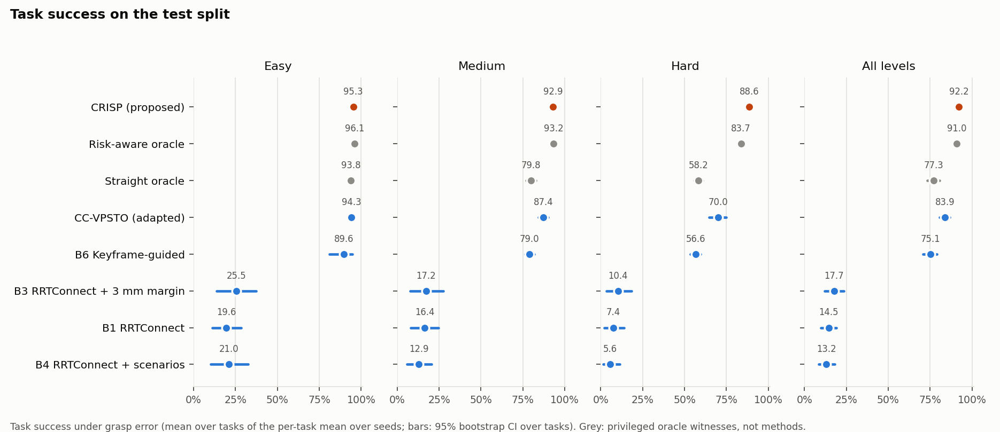
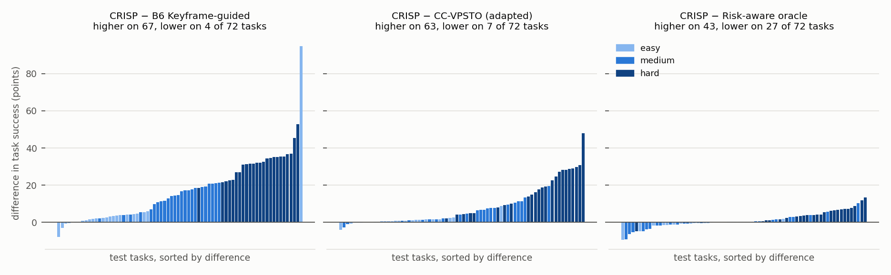
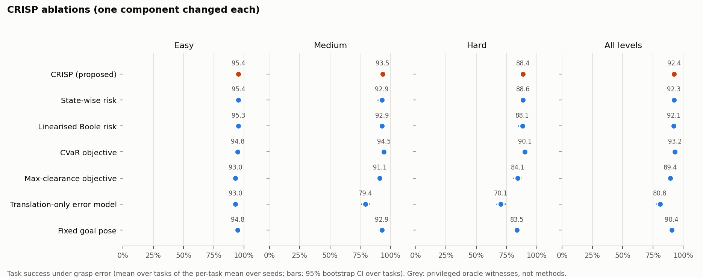
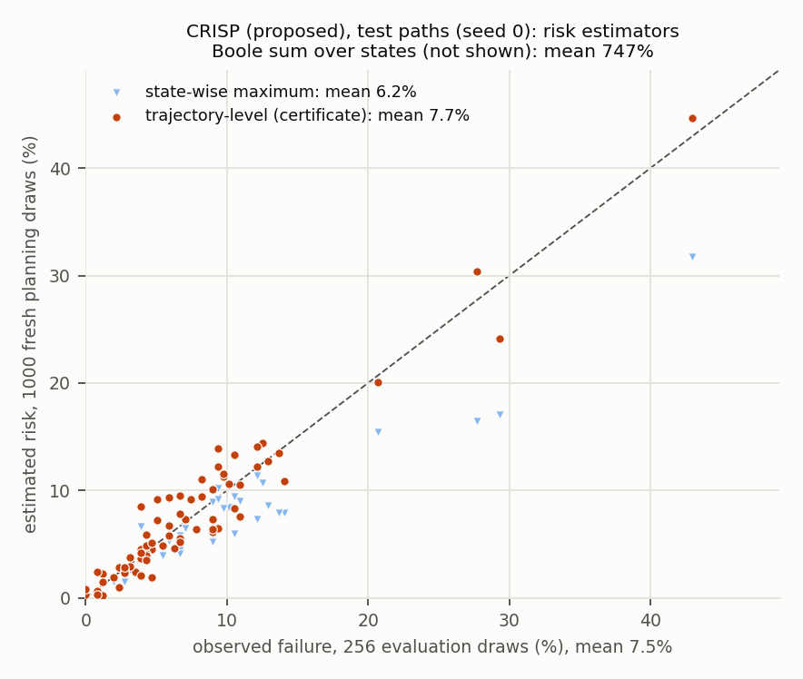
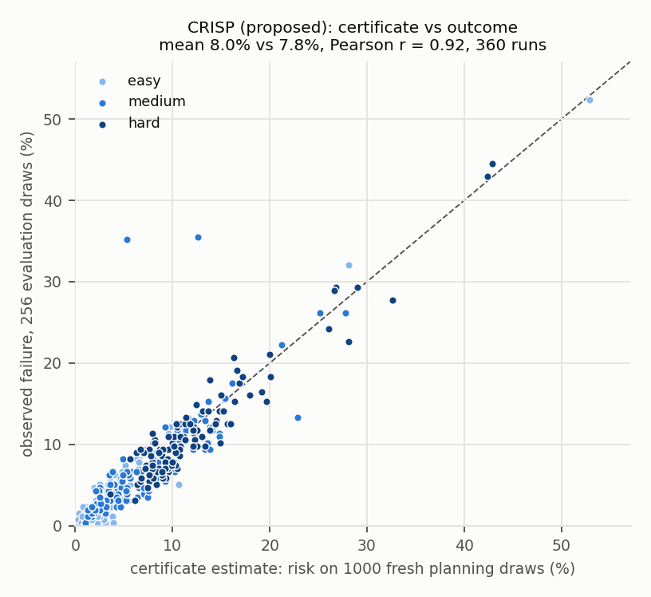
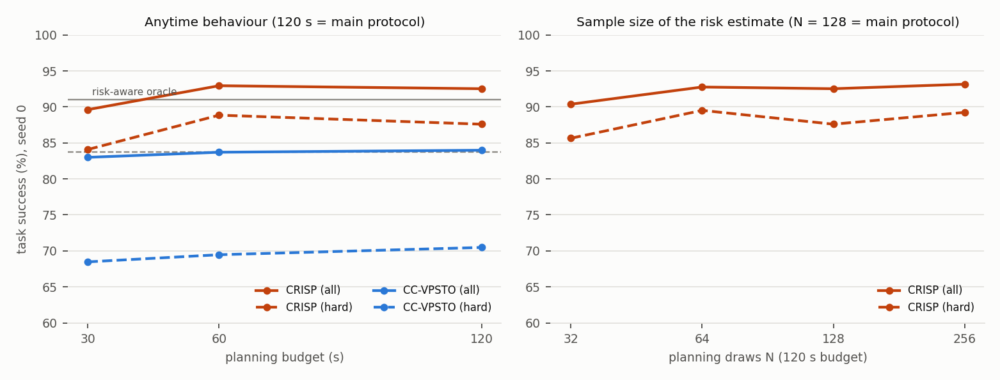
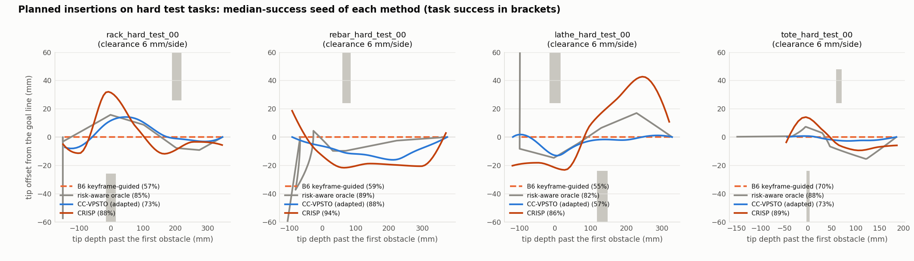
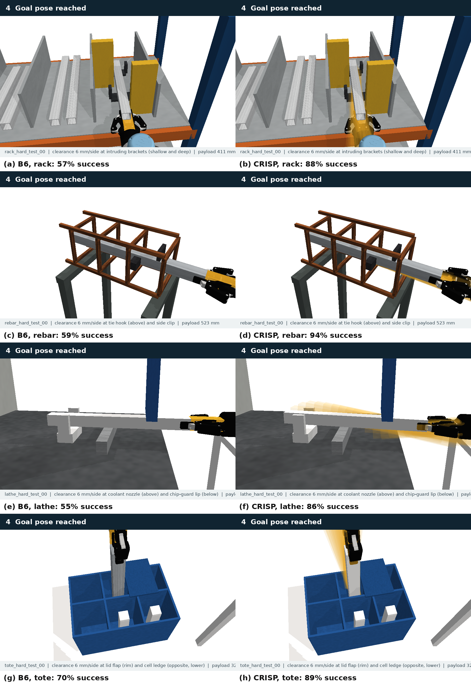
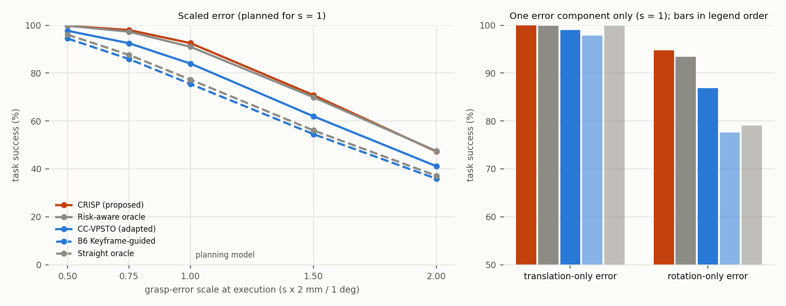

# CRISP: chance-optimal insertion planning under in-hand grasp error

This document describes the method proposed with gosuite v0.4: the problem, the method, its theory, how it relates to recent work, the comparators and ablations, the development protocol, and the results. Code: [gosuite/planners/crisp.py](../gosuite/planners/crisp.py) (planner), [gosuite/risk.py](../gosuite/risk.py) (risk model), [gosuite/planners/ccvpsto.py](../gosuite/planners/ccvpsto.py) (recent comparator).

## 1. Problem

A robot carries an elongated payload through one or more openings to a goal region. The payload sits in the hand with an unknown error ξ = (δt, φ) ~ N(0, Σ), Σ = diag(σ_t² I₃, σ_r² I₃), drawn once per execution and held for the whole motion (2 mm and 1° per axis in the suite). A path π succeeds for ξ if the perturbed payload never touches the environment, stays inside the keep-in regions, and its final state meets the goal and placement rules. The planner should maximise

  p_succ(π) = Pr_ξ[ success(π, ξ) ],

which is exactly the benchmark's task success.

Two properties shape the problem:

1. **The error is static.** It is a parameter of the execution, not process noise. The failure event of a path is a union over its states, F(π) = ∪_t F_t(π). Consecutive F_t overlap strongly, because the same ξ sweeps past the same obstacle.
2. **Lever arm.** A payload point p in the hand frame moves by Exp(φ)p + δt − p. Its norm is at most |δt| + 2 sin(|φ|/2)|p| ≤ |δt| + |φ||p|. To first order, the displacement along a contact normal n has variance σ_t² + σ_r² |n × p|². The same clearance is therefore much riskier at the payload tip (|p| ≈ 0.45 m) than near the hand. With 1° and 2 mm, the tip's standard deviation is about 8 mm against 2 mm.

## 2. Method

CRISP keeps the structure of the keyframe-guided planner (B6). Keyframes come from the declared openings: the payload is retracted from the goal along each opening's axis. A joint-space transfer from the start connects to the insertion. CRISP replaces the straight insertion with one that is chance-optimal.

1. **Parameterisation.** The insertion is the straight keyframe motion P₀(s), s ∈ [0, 1], composed with a deviation D(s; θ) in the payload frame. At K + 1 = 7 knots, θ holds the lateral and vertical offsets of the payload's front and rear ends, so position, yaw and pitch are all free. Offsets follow a monotone cubic (PCHIP) between knots. The goal knot also has an axial offset. The **goal pose is chosen inside the goal region** rather than fixed to its nominal value. The front/rear-end coordinates make clearances at obstacles near-linear in θ, independent of where the obstacles are, so no task-specific structure is needed.
2. **Exact sampled risk.** The objective is a sample-average approximation (SAA) on N = 128 planning-stream draws, common to all candidates. For each draw, the payload is propagated exactly through SE(3) along the whole insertion. The margin of each draw is its smallest separation over all states and obstacles, together with the final-state rule margins. Separations are separating-axis margins between oriented boxes. Every obstacle in the suite is a box. A keep-in rule's forbidden set, the restricted box minus the allowed box, is a union of at most six boxes. A (state, box, draw) triple is skipped when its nominal separation exceeds the draw's largest point displacement |δt| + |φ| ℓ_max. This pruning is exact by the lever-arm bound. A candidate costs 5–40 ms.
3. **Objective.** The cost is J(θ) = (1/N) Σᵢ σ(−mᵢ(θ)/τ) + penalty + regulariser. Here σ is the logistic function, mᵢ is the trajectory-level margin of draw i, the penalty requires a nominal margin of at least 1 mm, and the regulariser is a small quadratic term on θ. The smoothed indicator (Peña-Ordieres et al., SIAM J. Optim. 2020) breaks ties between candidates with the same empirical risk. Its width must be small: τ = 0.05 mm. A wider sigmoid charges every near-miss draw. A risk-optimal path threads closely, so many draws pass with sub-millimetre margins, and the surrogate would rank it worse than the straight insertion (Section 6).
4. **Optimisation.** The method runs in two stages.
   - Stage 1 runs CMA-ES on the goal knot alone. It minimises the final-state risk, which is a floor for every path ending at that goal.
   - Stage 2 runs CMA-ES (Hansen 2016) on all knots, starting from the stage-1 goal, for 60% of the planning budget.
5. **Realisation.** The arm follows the best distinct candidates in order, by IK continuation backwards from the goal. Every interpolated state is checked for arm collisions and keep-in, and the path is checked at the evaluation resolution. If tracking fails while the payload is still outside the first opening, the insertion starts at the last tracked state (adaptive pre-entry). The transfer from the start uses RRTConnect, as in B6. If nothing can be tracked, the planner falls back to B6.
6. **Certificate.** The executed path is re-scored on M = 1000 further planning draws. The planner reports the empirical risk and its one-sided 95% Clopper–Pearson upper bound. These draws are independent of the optimisation, so the bound is valid for the modelled failure modes (calibration: Section 7.5).

CRISP reads only the planner interface: obstacle boxes, payload geometry and grasp, openings, the goal region, keep-in and placement rules, q_start, q_goal_reference (as an IK seed) and the grasp-error distribution. It never reads the generator's design block, the descriptors, the obstacle roles or the witnesses. [tests/test_crisp.py](../tests/test_crisp.py) checks this by planning on a scene with that metadata removed.

## 3. Theory and evidence for the design

**Proposition 1 (trajectory-level vs per-state risk).** For a static error, max_t Pr[F_t] ≤ Pr[F] ≤ min(1, Σ_t Pr[F_t]).
- A state-wise chance constraint (bound on max_t Pr[F_t]; B4, CC-RRT per step) can accept paths whose true risk is up to T times its bound.
- Risk allocation over states (Boole; CC-RRT, p-Chekov, SCORA) is conservative by up to a factor T.

On the straight insertions of the 24 dev tasks (about 105 states, 1000 draws), the true trajectory risk is 1.2–1.55 times the state-wise maximum, and the Boole sum is 22–43 times the true risk:

| Level | Trajectory risk | State-wise max | Boole sum |
|---|---:|---:|---:|
| easy | 6.4% | 4.4% | 1.67 |
| medium | 19.5% | 13.3% | 6.60 |
| hard | 42.0% | 35.7% | 19.04 |

Neither per-state quantity correctly states a path's risk. On the planned test paths, the state-wise maximum is optimistic (0.8× the observed failure) and the Boole sum is uninformative (60–100×); only the trajectory-level estimate is calibrated (Section 7.5). As optimisation objectives, however, the three rank candidate paths alike (Section 7.3). This matches the argument of de Groot et al. (IJRR 2025) for joint, horizon-level risk with dynamic obstacles.

**Lemma 2 (exact pruning).** |Exp(φ)p + δt − p| ≤ |δt| + |φ||p|. The separating-axis margin never exceeds the distance between two boxes, so a (state, box) pair whose nominal margin exceeds the draw's displacement bound cannot touch for that draw. Tests check that pruning never changes a failure indicator.

**Validation of the risk model against the simulator.**
- *Contacts:* per (state, draw), the box model flagged every payload-environment contact and keep-in violation PyBullet found, with zero misses over 1.26 million checks on the 24 dev witnesses. It disagreed on 0.017% of checks, always conservatively and always by less than 0.5 mm of overlap.
- *Final-state rules:* they agree with the suite's goal-feasibility flags on 6140 of 6144 dev draws, again with conservative disagreements only.

## 4. Relation to recent work

| Line of work | Representative papers | Uncertainty / risk | Difference from CRISP |
|---|---|---|---|
| Per-step chance constraints and risk allocation | Blackmore et al. 2011; Ono & Williams (IRA); CC-RRT (Luders et al. 2010), CC-RRT* (2013); p-Chekov (Dai et al. 2019); SCORA (Dawson et al. 2023) | Gaussian motion/obstacle noise, linearised, Boole over steps | Per-step and linearised. For a static error, Boole is conservative by up to a factor T (Prop. 1). Represented by the "linearised Boole" ablation. |
| Trajectory-level (joint) sampled risk | de Groot et al. IJRR 2025 (scenario MPC); CC-VPSTO (Brudermüller et al. IJRR 2026); Lew et al. RA-L 2023 (CVaR via SAA) | Samples of obstacle trajectories or dynamics | Same principle. CRISP adds exact SE(3) propagation of a static in-hand error, a lever-arm-aware task-space parameterisation and a free goal. CC-VPSTO is re-implemented as a comparator and CVaR is an ablation. |
| Risk contours / SOS | Jasour et al. RSS 2021, IJRR | Probabilistic obstacles, polynomial | Needs polynomial geometry. Does not scale to a 6-DOF arm with a rigid payload through openings. |
| Probabilistic collision detection with pose uncertainty | Wang, Chirikjian et al. 2025 (SE(3), superquadrics); Schmerling & Pavone RSS 2017 (importance sampling); Sun et al. ISRR 2013 | Per-query collision probability | Checking tools, not planners. CRISP's box model is exact for the suite's geometry and fast enough to optimise with. |
| Parametric (static) uncertainty | Sensitivity-aware planning: Brault et al. ICRA 2021; Srour et al. RA-L 2024 (payload uncertainty) | Minimise state sensitivity to parameters | Minimises a sensitivity index, not the success probability. Nothing ties clearance to sensitivity. |
| Elongated objects through openings | TAPOM (Li et al. 2025) | Deterministic | Topology keyframes. B6 and CRISP share this structure. |
| Pose uncertainty in manipulation planning | Hsiao et al. 2011 (robust grasping); Berenson et al. IROS 2009 (task space regions); fine-motion preimages (Lozano-Pérez et al. 1984) | Bounded or belief-space pose uncertainty | Complementary: these reduce or tolerate the uncertainty by sensing, compliance or set-based reasoning; CRISP is an open-loop, probability-optimal planner, and its risk would shrink with any of them. |

**Gap addressed.** No existing planner maximises the trajectory-level success probability under a static SE(3) in-hand error with exact geometry. The lever-arm structure is exploited in the suite only by the generator's oracle, which uses privileged knowledge of where the intruding obstacles are and which deviation planes help.

## 5. Comparators and ablations

All comparators use the same keyframe structure, transfer planner, budget (120 s), evaluation draws and harness.

- **CC-VPSTO (adapted)** (Brudermüller et al., IJRR 2026). Joint-space via-points (5) through a clamped cubic spline from the pre-entry configuration to q_goal_reference, warm-started from the tracked straight insertion. The trajectory-wise chance constraint s_N ≤ k_binom(β = 0.05, N = 100, η = 0.05) uses their exact binomial padding; the thresholds reproduce their published values. Their barrier penalty ranks every infeasible candidate below every feasible one, then by excess violations. CMA-ES runs on draws taken once. It shares CRISP's exact risk estimator and arm check, so the comparison isolates formulation and parameterisation. Its step size σ₀ was tuned on dev (0.002–0.03 rad), and 0.005 was best.
- **Ablations** change one component of CRISP:
  - state-wise risk (max_t of the per-state failure probability);
  - linearised Boole risk (first-order Gaussian per (state, box), summed);
  - CVaR₀.₁ of the negative margin (risk-averse SAA);
  - max-clearance (deterministic, no error model);
  - translation-only error model (no lever arm);
  - fixed goal pose.

## 6. Development protocol

Everything below was decided on the dev split (24 tasks), using planning-stream draws, which never coincide with evaluation draws. The test split was run once, after development closed.

| Decision | Dev evidence (medium + hard dev tasks, fresh planning draws) |
|---|---|
| CMA-ES instead of CEM | Insertion risk 15.3% vs 16.3% (same bounds); CEM was stuck on the hard rack tasks |
| Goal-first stage | 11.2% vs 15.3% |
| Offsets ±60 mm, goal ±10 mm (were ±30/±6) | The oracle yaws the rear end by up to 46 mm; CEM 16.3% vs 18.5% |
| N = 128 draws and 60% of the budget (was N = 192, 45%) | 7.9% (2 seeds) vs 11.4% (1 seed): cheaper evaluations buy more CMA-ES iterations; N = 64 gives 9.9%, too few draws |
| No IPOP restart | One restart halves each run's iterations: 15.9% vs 11.4% |
| No held-out re-ranking | 7.9% with vs 8.0% without; dropped to keep the method lean |
| Smoothing width τ = 0.05 mm (was 0.5 mm) | At τ = 0.5 mm the surrogate scored a path with 0% sampled failures (true risk 8.2%) as worse than the straight insertion (12.5%, true 18.6%), because near-misses dominate. Over all 24 dev tasks with 2 seeds: τ = 0.5 mm 6.9% vs τ = 0.05 mm 6.4% (4 seeds); the gain is on easy and medium tasks, where optimised paths thread closely |
| No separate final-state estimate | Scoring the final state on 1024 extra draws (unbiased union estimate E[a] + E[b] − E[ab]) to resolve goal-tolerance tails: +0.2 points, better on 13/24 tasks, Wilcoxon p = 0.86 (4 seeds); not used |
| Shrinkage candidates θ·{0.8, 0.6, 0.4, 0.2} | rack_easy_dev_00: on 2 of 3 seeds every near-duplicate candidate failed the arm check (arm–rack contact) and the straight insertion was used |
| Transfer reserve | The transfer's shortcutting runs until its deadline; 12 s is reserved for validation and the certificate so runs end within the 120 s budget |
| Adaptive pre-entry | Hard rack: the arm self-collides at the start of a 6 cm approach; without it every candidate fell back to B6 |
| CC-VPSTO σ₀ = 0.005 rad | 20.3% whole-path risk vs 21.5% (0.002), 23.0% (0.01), 27.0% (0.03) |

## 7. Results on the frozen test split

The test split (72 tasks) was run once, with the code hashed in `results/suite_v0.4/crisp/code_sha256.json`. The run comprised 2016 planner runs; every one returned a valid path, and none exceeded the 120 s budget. Full references are in `paper/references.bib`. The tables are generated by `python -m gosuite.compare` (outputs in `results/suite_v0.4/comparison_crisp_test/` and `comparison_crisp_ablation_test/`) and the figures by `python -m gosuite.crisp_figures`.

### 7.1 Main results

Task success under grasp error (%), with planning failures counted as 0. Values are means over tasks of the per-task mean over seeds; the interval is a 95% bootstrap over tasks.

| Method | Valid path | Easy | Medium | Hard | All [95% CI] | Collision \| valid |
|---|---:|---:|---:|---:|---:|---:|
| **CRISP (proposed)** | 100% | 95.3 | 92.9 | **88.6** | **92.2** [91.0, 93.3] | 5.3 |
| Risk-aware oracle (privileged) | 100% | 96.1 | 93.2 | 83.7 | 91.0 [89.5, 92.4] | 7.7 |
| Straight oracle | 100% | 93.8 | 79.8 | 58.2 | 77.3 [73.3, 80.8] | 21.8 |
| CC-VPSTO (adapted, IJRR 2026) | 100% | 94.3 | 87.4 | 70.0 | 83.9 [80.6, 86.8] | 15.0 |
| B6 Keyframe-guided | 99% | 89.6 | 79.0 | 56.6 | 75.1 [70.7, 79.2] | 23.0 |
| B3 RRTConnect + 3 mm margin | 27% | 25.5 | 17.2 | 10.4 | 17.7 [12.1, 23.5] | 34.3 |
| B1 RRTConnect | 31% | 19.6 | 16.4 | 7.4 | 14.5 [9.8, 19.0] | 53.3 |
| B4 RRTConnect + scenarios | 21% | 21.0 | 12.9 | 5.6 | 13.2 [8.4, 18.3] | 36.5 |

Paired differences (percentage points). All methods face the same draws, so tasks are compared one by one. p is a two-sided Wilcoxon signed-rank test over the 72 tasks, Holm-adjusted over the five comparisons.

| A − B | Easy | Medium | Hard | All [95% CI] | Tasks A higher / lower | p (Holm) |
|---|---:|---:|---:|---:|---:|---:|
| CRISP − B6 Keyframe-guided | +5.7 | +13.9 | +31.9 | +17.1 [+13.5, +21.0] | 67 / 4 | 8.4e-12 |
| CRISP − CC-VPSTO (adapted) | +1.0 | +5.5 | +18.6 | +8.4 [+6.1, +11.0] | 63 / 7 | 4.8e-11 |
| CRISP − risk-aware oracle | −0.8 | −0.4 | +4.9 | +1.3 [+0.3, +2.3] | 43 / 27 | 0.029 |
| CRISP − straight oracle | +1.5 | +13.1 | +30.3 | +15.0 [+12.1, +18.1] | 67 / 4 | 1.0e-11 |
| CC-VPSTO − B6 | +4.7 | +8.3 | +13.3 | +8.8 [+5.7, +12.3] | 62 / 9 | 4.3e-10 |

How to read these results:

- **CRISP is the best method, and its advantage grows with difficulty.** It gains +17.1 points over the keyframe-guided baseline and +8.4 over CC-VPSTO. At the hard level the margins are +31.9 and +18.6, and CRISP is higher on all four families.
- **CRISP matches the privileged oracle without its privileges.** Overall it is +1.3 points above it. It is slightly lower at easy and medium (−0.8, −0.4) and higher at hard (+4.9). At hard it leads in every family: rack 83.8 vs 81.4, rebar 90.2 vs 82.9, lathe 88.8 vs 84.3, tote 91.5 vs 86.1. It is lower on rack medium (85.9 vs 89.8) and tote medium (95.2 vs 97.2).
- **Unguided planners are limited by feasibility, not risk.** B1, B3 and B4 return a valid path in 21–31% of runs.

### 7.2 Where the gain comes from

Episodes are split by whether the grasp draw is feasible at the task's reference goal pose. That holds for 92.8% of draws; the rest fail even when the payload is parked at the reference goal.

| Method | Success, reference goal feasible | Success, reference goal infeasible | Failures per episode: contact / goal position / placement |
|---|---:|---:|---|
| CRISP | 96.4% | **38.0%** | 5.2% / 1.6% / 0.8% |
| CRISP, fixed goal (ablation) | 97.4% | 0.0% | 8.0% / 0.8% / 0.5% |
| Risk-aware oracle | 98.0% | 0.0% | 7.7% / 0.7% / 0.7% |
| CC-VPSTO (adapted) | 90.4% | 0.0% | 14.9% / 0.7% / 0.5% |
| B6 Keyframe-guided | 82.1% | 0.0% | 22.9% / 0.5% / 0.3% |

On draws whose reference goal is feasible, the oracle's privileged path is the best, CRISP is 1.6 points behind, and its fixed-goal ablation is 0.6 points behind. CRISP's net advantage over the oracle comes from choosing the goal pose inside the goal region. This recovers 38% of the draws that every fixed-goal method loses, at the price of a few more goal-tolerance failures.

### 7.3 Ablations (three seeds; one component changed each)

| Variant | Easy | Medium | Hard | All [95% CI] | CRISP − variant | Tasks CRISP higher / lower | p (Holm) |
|---|---:|---:|---:|---:|---:|---:|---:|
| CRISP (seeds 0–2) | 95.4 | 93.5 | 88.4 | 92.4 [91.1, 93.6] | | | |
| Translation-only error model | 93.0 | 79.4 | 70.1 | 80.8 [77.9, 83.4] | **+11.6** | 68 / 3 | 2.8e-12 |
| Max-clearance objective | 93.0 | 91.1 | 84.1 | 89.4 [87.7, 90.9] | **+3.0** | 60 / 10 | 5.6e-09 |
| Fixed goal pose | 94.8 | 92.9 | 83.5 | 90.4 [88.8, 91.9] | **+2.0** | 44 / 24 | 8.1e-04 |
| State-wise risk | 95.4 | 92.9 | 88.6 | 92.3 [90.8, 93.6] | +0.1 | 36 / 34 | 0.84 |
| Linearised Boole risk | 95.3 | 92.9 | 88.1 | 92.1 [90.6, 93.4] | +0.3 | 27 / 43 | 0.61 |
| CVaR₀.₁ objective | 94.8 | 94.5 | 90.1 | 93.2 [91.9, 94.3] | −0.7 | 20 / 50 | 0.012 |

What the ablations show:

1. **The lever arm is the dominant factor.** A planner that models only the translational error loses 11.6 points, and 18.3 at hard. It does not see that the risk sits at the payload tip.
2. **Probabilistic beats geometric robustness.** Maximising the smallest nominal clearance, the classical heuristic, loses 3.0 points, and 4.3 at hard: clearance at the tip and clearance near the hand are not equally valuable.
3. **The free goal pose is worth 2.0 points**, and 4.9 at hard (Section 7.2).
4. **The risk functional is second-order for optimisation.** State-wise, linearised-Boole and trajectory-level objectives give statistically indistinguishable plans: the failure sets of consecutive states are nested, so they rank candidates alike. Their difference is calibration, not ranking (Section 7.5).
5. **CVaR does slightly better.** The tail objective CVaR₀.₁ of the negative margin, as in Lew et al., is 0.7 points better than CRISP's chance objective (Holm p = 0.012); the gain is at medium and hard. Pushing the worst-case margins outward appears to generalise better to the evaluation draws. This variant was **not** selected on the dev split, so it is reported as a finding, not adopted after the fact. Re-validating it requires a fresh test set.

### 7.4 Runtime

- **CRISP:** the median optimisation takes 43 s (5525 candidate evaluations, about 128 per second on one core). The first candidate is arm-feasible in 96% of runs (347 of 360). A shrinkage candidate was used in 9 runs, a lower-ranked candidate in 1, and the straight insertion in 3 (Section 8). The pre-entry was shortened in 58 runs, and the planner never fell back to B6. The median planning time is 109 s, because the RRT-Connect shortcutting step it shares with B6 runs to its deadline.
- **CC-VPSTO:** 2610 evaluations at 37 per second, slower because each candidate needs forward kinematics of a joint-space spline.

### 7.5 Calibration of risk estimates on the planned paths

For the seed-0 test paths of CRISP and of two ablations, the trajectory-level risk, the state-wise maximum and the Boole sum were estimated on 1000 fresh planning draws (a stream no planner used) and compared with the failure observed on the 256 evaluation draws.

Risk estimators against the observed failure (%). Each estimator column gives its mean, its ratio to the observed mean, and the number of runs it underestimates. Source: `results/suite_v0.4/comparison_crisp_test/risk_estimators.json`.

| Paths | Observed failure | Trajectory-level | State-wise maximum | Boole sum |
|---|---:|---:|---:|---:|
| CRISP (proposed) paths | 7.5 | 7.7 (1.03×; 35/72) | 6.2 (0.83×; 49/72) | 747 (100×) |
| state-wise risk paths | 7.7 | 7.8 (1.01×; 35/72) | 5.9 (0.77×; 54/72) | 745 (97×) |
| linearised Boole risk paths | 7.5 | 7.7 (1.03×; 33/72) | 6.5 (0.87×; 45/72) | 442 (59×) |

The trajectory-level estimate is calibrated. Its ratio to the observed failure is 1.01–1.03, and it underestimates in about half of the runs, as a calibrated estimate should. The state-wise maximum is optimistic: it reports 77–87% of the true risk and underestimates in 45–54 of 72 runs, with the largest gaps on the riskiest paths (figure below). The Boole sum exceeds 100% on average (59–100× the true risk) and carries no information. Across all 360 CRISP test runs, the certificate predicted a mean failure of 8.0% against 7.8% observed (Pearson r = 0.92). So although the three functionals rank candidate paths alike (Section 7.3), only the trajectory-level one is a correct statement about the path that is executed. This is the practical content of Proposition 1.

 

### 7.6 Anytime behaviour and sample size

Seed 0 throughout. The 120 s and N = 128 rows are the seed-0 runs of the main experiment, and "CRISP, 120 s" is the same run as N = 128.

Task success (%) by planning budget and by number of planning draws N. Source: `results/suite_v0.4/comparison_crisp_test/anytime.json`.

| Variant | Easy | Medium | Hard | All [95% CI] | Planning time (s, median) |
|---|---:|---:|---:|---:|---:|
| CRISP, 30 s | 95.0 | 89.7 | 84.1 | 89.6 [87.0, 92.1] | 38 |
| CRISP, 60 s | 96.1 | 93.8 | 88.9 | 92.9 [91.7, 94.1] | 59 |
| CRISP, 120 s | 96.2 | 93.8 | 87.6 | 92.5 [90.8, 94.0] | 109 |
| CC-VPSTO, 30 s | 93.7 | 86.8 | 68.5 | 83.0 [79.3, 86.5] | 36 |
| CC-VPSTO, 60 s | 94.5 | 87.2 | 69.5 | 83.7 [80.2, 86.8] | 50 |
| CC-VPSTO, 120 s | 94.0 | 87.5 | 70.5 | 84.0 [80.7, 86.9] | 85 |
| CRISP, N = 32 | 93.3 | 92.1 | 85.6 | 90.4 [88.3, 92.1] | 90 |
| CRISP, N = 64 | 95.7 | 93.1 | 89.5 | 92.8 [91.7, 93.9] | 109 |
| CRISP, N = 256 | 96.3 | 93.9 | 89.2 | 93.2 [91.9, 94.3] | 109 |

CRISP is a useful anytime planner. With a quarter of the budget (30 s) it reaches 89.6%, more than CC-VPSTO with 120 s (84.0%), and its hard-level success (84.1%) already matches the privileged oracle (83.7%). Beyond 60 s nothing changes, because CMA-ES converges in about 43 s. CC-VPSTO gains only 1.0 point from 30 to 120 s.

The risk estimate needs some, but not many, draws. N = 32 costs 2.1 points relative to N = 128, spread over all levels (−2.9, −1.7 and −2.0 points at easy, medium and hard). N = 64 and N = 256 are within the seed-to-seed spread of N = 128 (92.8% and 93.2% against 92.5%).

### 7.7 Representative paths

These figures show the median-success seed of each method on the first hard test task of each family, as tip offsets and as simulator close-ups with the payload trail. B6's trail is hidden behind the payload, because its insertion stays on the goal line. Without information on where the intruding obstacles are, CRISP recovers the oracle's lever-arm strategy, usually with a larger amplitude: the tip swings away from each obstacle while passing it with the long lever arm, then converges to the goal line. The outlines and the plotting plane come from the generator's design block and are used only for drawing.

### 7.8 Robustness to a misspecified error model

Every method planned with the protocol error model (s = 1, rotation and translation combined). Its stored seed-0 test paths (the oracles' witnesses) were then executed again under misspecified models: every standard deviation scaled by s, with common random numbers (the same normal draws, scaled), and translation-only and rotation-only errors at s = 1. No method replanned. Tasks without a path count as 0. Source: `results/suite_v0.4/robustness_crisp_test/` (`python -m gosuite.robustness --config configs/robustness_crisp_v0.4.json`).

Task success (%) under each execution error model:

| Method | s = 0.5 | s = 0.75 | s = 1 | s = 1.5 | s = 2 | translation-only, s = 1 | rotation-only, s = 1 |
|---|---:|---:|---:|---:|---:|---:|---:|
| CRISP (proposed) | 99.8 | 98.0 | 92.5 | 70.8 | 47.3 | 99.9 | 94.8 |
| Risk-aware oracle | 99.8 | 97.3 | 91.0 | 70.0 | 47.5 | 99.9 | 93.4 |
| CC-VPSTO (adapted) | 97.7 | 92.5 | 84.0 | 62.0 | 41.2 | 99.1 | 86.8 |
| B6 Keyframe-guided | 94.4 | 85.9 | 75.5 | 54.5 | 35.9 | 97.8 | 77.6 |
| Straight oracle | 96.1 | 87.6 | 77.3 | 56.1 | 37.2 | 99.9 | 79.0 |

Paired differences in percentage points (two-sided Wilcoxon over the 72 tasks, unadjusted):

| Paired difference (seed 0) | s = 0.5 | s = 0.75 | s = 1 | s = 1.5 | s = 2 | translation-only, s = 1 | rotation-only, s = 1 |
|---|---:|---:|---:|---:|---:|---:|---:|
| CRISP − B6 Keyframe-guided | +5.3 (p=1e-13) | +12.1 (p=9e-12) | +17.1 (p=5e-13) | +16.3 (p=1e-12) | +11.3 (p=6e-12) | +2.1 (p=0.005) | +17.2 (p=6e-13) |
| CRISP − CC-VPSTO (adapted) | +2.1 (p=1e-06) | +5.5 (p=2e-09) | +8.5 (p=1e-11) | +8.8 (p=1e-11) | +6.1 (p=6e-10) | +0.9 (p=8e-06) | +8.0 (p=1e-11) |
| CRISP − Risk-aware oracle | +0.0 (p=0.06) | +0.7 (p=0.002) | +1.5 (p=0.0009) | +0.9 (p=0.2) | -0.2 (p=0.7) | +0.1 (p=0.04) | +1.4 (p=0.0002) |

What this shows:

- **The ranking holds when the error model is wrong.** From half to twice the planned error, CRISP stays ahead of CC-VPSTO (+2.1 to +8.8 points) and B6 (+5.3 to +17.1), with p ≤ 10⁻⁶ at every scale. The gain is largest near the planning model and shrinks when the error becomes so small that every path succeeds, or so large that every path fails. At 1.5× and 2× the planned error, CRISP is level with the privileged oracle (+0.9 and −0.2, not significant). Nothing suggests that CRISP over-fits the error scale it planned for.
- **The risk is rotational.** Under translation-only errors every method succeeds 97.8–99.9% of the time. Under rotation-only errors B6 falls to 77.6% and CC-VPSTO to 86.8%, while CRISP keeps 94.8%, above the oracle's 93.4%. This is the lever-arm thesis measured directly, and it agrees with the translation-only ablation (−11.6 points).

## 8. Limitations

- **Simulation only.** The evaluation is kinematic: it has no contact dynamics, compliance or tracking error, and there is no real-robot evidence.
- **The error model is assumed known.** It is Gaussian, isotropic per axis and uncalibrated. Section 7.8 tests misspecification of its scale and components; other shapes (bias, heavy tails) are not tested.
- **The arm is not in the optimiser.** Its feasibility is checked only after optimisation. In 3 of 360 test runs (rack tasks) every candidate and every shrinkage candidate made the arm touch the rack, and the straight insertion was used.
- **Box geometry only.** The risk model is exact for boxes, which is all the suite contains. Meshes would need a convex decomposition or a distance query, and that would be slower.
- **The certificate covers only modelled failures.** It is valid for payload–environment contact, keep-in and the final-state rules. Payload–arm contacts (0.2% of evaluation episodes) are outside it.
- **Two variants were found after the fact.** CVaR's slight advantage and the median-seed choice for figures were observed after the test run. Neither changed the reported method.
