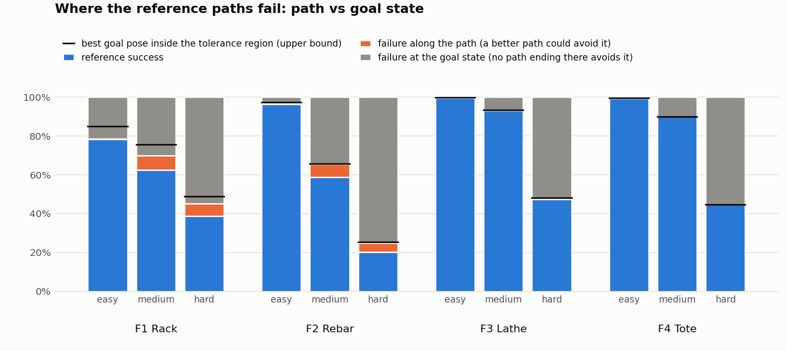
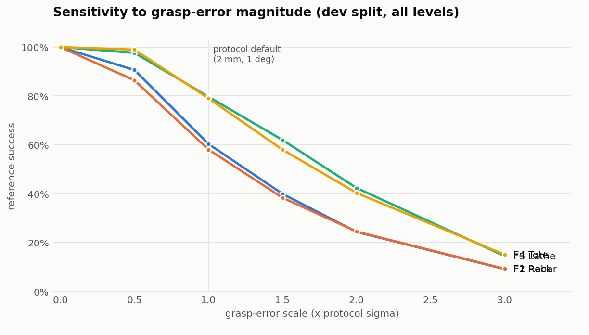

# Validation of gosuite v0.3

Generated by `python -m gosuite.validate` and `python -m gosuite.validation_report`. Every number uses the protocol draws (256 episodes per task, 2 mm / 1 deg).

## 1. Headroom: where do the reference paths fail?

A failure at the goal state happens for the drawn grasp error even with the payload parked at the goal configuration. Every path that ends there loses that episode. "Path failure" is the rest: episodes that a better path ending at the same goal could win. "Goal-region bound" is the best static success over goal poses inside the tolerance region.

| Family | Level | Reference success | Path failure | Goal-state failure | Bound at q_goal_reference | Goal-region bound |
|---|---|---:|---:|---:|---:|---:|
| rack | easy | 78.3% | 0.3% | 21.4% | 78.6% | 84.9% |
| rack | medium | 62.6% | 7.4% | 30.0% | 70.0% | 75.6% |
| rack | hard | 38.8% | 6.3% | 54.9% | 45.1% | 49.0% |
| rack | all | 59.9% | 4.7% | 35.4% | 64.6% | 69.8% |
| rebar | easy | 96.2% | 0.8% | 2.9% | 97.1% | 97.3% |
| rebar | medium | 58.7% | 6.7% | 34.6% | 65.4% | 65.6% |
| rebar | hard | 20.3% | 4.6% | 75.1% | 24.9% | 25.5% |
| rebar | all | 58.4% | 4.1% | 37.5% | 62.5% | 62.8% |
| lathe | easy | 99.7% | 0.0% | 0.3% | 99.7% | 99.7% |
| lathe | medium | 93.1% | 0.0% | 6.8% | 93.2% | 93.3% |
| lathe | hard | 47.4% | 0.1% | 52.5% | 47.5% | 48.2% |
| lathe | all | 80.1% | 0.0% | 19.9% | 80.1% | 80.4% |
| tote | easy | 99.4% | 0.0% | 0.6% | 99.4% | 99.5% |
| tote | medium | 89.9% | 0.0% | 10.1% | 89.9% | 89.9% |
| tote | hard | 44.6% | 0.0% | 55.4% | 44.6% | 44.6% |
| tote | all | 78.0% | 0.0% | 22.0% | 78.0% | 78.0% |
| all | easy | 93.4% | 0.3% | 6.3% | 93.7% | 95.4% |
| all | medium | 76.1% | 3.5% | 20.4% | 79.6% | 81.1% |
| all | hard | 37.8% | 2.8% | 59.5% | 40.5% | 41.8% |
| all | all | 69.1% | 2.2% | 28.7% | 71.3% | 72.8% |

## 2. Evaluation-step convergence

| Task | Success at 0.0025 rad | Success at 0.00125 rad | Episodes with a different outcome |
|---|---:|---:|---:|
| rack_easy_dev_00 | 78.9% | 78.9% | 0 |
| rack_medium_dev_00 | 71.1% | 71.1% | 0 |
| rack_hard_dev_00 | 35.9% | 35.9% | 0 |
| rebar_easy_dev_00 | 94.5% | 94.5% | 0 |
| rebar_medium_dev_00 | 53.1% | 53.1% | 0 |
| rebar_hard_dev_00 | 23.0% | 23.0% | 0 |
| lathe_easy_dev_00 | 100.0% | 100.0% | 0 |
| lathe_medium_dev_00 | 92.6% | 92.6% | 0 |
| lathe_hard_dev_00 | 41.8% | 41.8% | 0 |
| tote_easy_dev_00 | 98.0% | 98.0% | 0 |
| tote_medium_dev_00 | 87.5% | 87.5% | 0 |
| tote_hard_dev_00 | 52.7% | 52.7% | 0 |

## 3. Sensitivity to the grasp-error model (dev split)

Per-task success is monotone non-increasing in the error scale for every dev task: **True**.

| Family | x0 | x0.5 | x1 | x1.5 | x2 | x3 | translation only (x1) | rotation only (x1) |
|---|---:|---:|---:|---:|---:|---:|---:|---:|
| rack | 100.0% | 90.6% | 60.4% | 39.9% | 24.3% | 9.1% | 99.5% | 63.9% |
| rebar | 100.0% | 86.4% | 58.1% | 38.3% | 24.5% | 9.2% | 99.5% | 59.8% |
| lathe | 100.0% | 97.7% | 79.7% | 62.0% | 42.3% | 14.5% | 99.3% | 83.1% |
| tote | 100.0% | 99.0% | 79.0% | 58.0% | 40.3% | 15.0% | 99.1% | 84.3% |
| all | 100.0% | 93.4% | 69.3% | 49.6% | 32.9% | 12.0% | 99.3% | 72.8% |

## 4. Difficulty descriptors

Spearman rank correlation with reference success over all 96 tasks.

| Descriptor | rho | p |
|---|---:|---:|
| design_clearance_m | 0.87 | 5.3e-31 |
| tip_sensitivity | 0.96 | 6.2e-53 |
| lever_arm_m | -0.39 | 8.8e-05 |
| payload_length_m | -0.39 | 8.8e-05 |
| min_nominal_clearance_m | 0.79 | 1.6e-21 |
| constrained_path_length_m | -0.48 | 8.4e-07 |
| portals | 0.03 | 7.6e-01 |

Tip sensitivity `c / (lever * sigma_r)` within each family: rack rho = 0.98, rebar rho = 0.98, lathe rho = 0.96, tote rho = 0.97.

## 5. Variance components (reference success)

| Cell | Between-task SD | Within-task binomial SE (256 episodes) |
|---|---:|---:|
| rack/easy | 4.4 pts | 2.6 pts |
| rack/medium | 4.4 pts | 3.0 pts |
| rack/hard | 4.6 pts | 3.0 pts |
| rebar/easy | 1.9 pts | 1.2 pts |
| rebar/medium | 4.9 pts | 3.1 pts |
| rebar/hard | 4.2 pts | 2.5 pts |
| lathe/easy | 0.4 pts | 0.4 pts |
| lathe/medium | 3.8 pts | 1.6 pts |
| lathe/hard | 6.7 pts | 3.1 pts |
| tote/easy | 0.7 pts | 0.5 pts |
| tote/medium | 3.5 pts | 1.9 pts |
| tote/hard | 6.1 pts | 3.1 pts |
